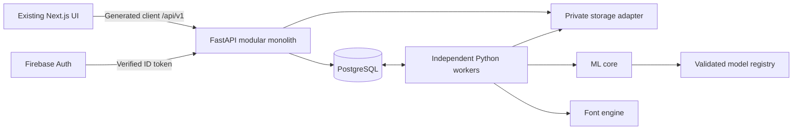

# Penforge backend, ML, and infrastructure plan

Status: Phases 00–10 implemented locally; Phase 10 ships measured spacing only, and Phase 08 advanced personalization and Phase 09 Devanagari remain independently gated by evidence. Phase 10–11 portable defects were audited and repaired on 2026-10-21; Phase 11 has local tooling and evidence, with its full public outcome incomplete and hosted/launch gates open in its [evidence](phase-11-deployment-operations/evidence.md). Phase 07 ordinary responsive/keyboard and project/withdrawal checks passed; OS-gentle and final account-deletion browser interaction remain unexecuted. Phase 06 browser/responsive acceptance remains unexecuted (browser use was disabled at that phase); full acceptance remains pending. Phase 03/04 current-wizard browser checks remain pending. Phase 05 automated, responsive browser and CoreText acceptance passed; its OS-gentle browser check is unexecuted.  
Date: 2026-10-21 (audit-repair update).  
Execution instruction: the user subsequently explicitly authorized Phase 09, then Phase 10, then Phase 11. Work sequentially without subtask agents and preserve earlier pending browser checks. Provider provisioning, credential grant, deployment and public launch remain unauthorized; the Phase 11 closeout stops at the owner decision and the recorded blockers.

## Authority and scope

The source is the complete [PENFORGE_CODEX_BACKEND_ML_INFRA_CONTEXT_v3.md](../specifications/PENFORGE_CODEX_BACKEND_ML_INFRA_CONTEXT_v3.md), preserved byte-for-byte in this workspace. [Source provenance](../specifications/README.md) records the original attachment and SHA-256. Part A's later explicit FINAL decisions refine Part B's v2 baseline. FINAL constraints remain binding; PROPOSED mechanics below are reviewable; PENDING and MEASURE items remain unresolved.

Phase 00 introduces a local API, PostgreSQL schema, contracts, adapters and research metadata validation. Phase 01 adds verified identity and lossless account claims. Phase 02 adds opt-in cloud project metadata with quota-safe creation and conflict-safe updates. Phase 03 adds private immutable image/stroke captures, bounded isolated verification and the first durable PostgreSQL worker; its [evidence](phase-03-capture-uploads/evidence.md) separates local PostgreSQL/emulator/browser checks from hosted gates. Phase 04 adds local structured-image and digital-stroke extraction, fenced candidates and explicit owner review; see its [evidence](phase-04-extraction-review/evidence.md). Phase 05 adds deterministic TTF/CFF OTF/WOFF2 compilation, layered validation and private downloads; see its [evidence](phase-05-font-export/evidence.md). Phase 06 hardens the same queue with verified checkpoints, atomic caps/quotas, cancellation and resumable events; see its [evidence](phase-06-queue-recovery/evidence.md). Phase 07 implements explicit consent, separate contribution copies, coordinated erasure and conservative retention on the same queue; see its [evidence](phase-07-privacy-deletion/evidence.md). Phase 08 adds deterministic personalization, authentic alternates, and gated registry/evaluation/planning; see its [evidence](phase-08-personalization/evidence.md). Phase 09 adds Unicode/grapheme and normalization boundaries, a bounded Devanagari capture inventory, explicit Indic geometry review, evidence-backed OpenType generation, HarfBuzz shaping and experimental exports; its [evidence](phase-09-devanagari/evidence.md) records that recognition, corpus, handwriting fidelity and production gates remain open. Phase 10 adds measured pair kerning from approved outlines behind a bounded `spacing` control, with the five validation layers and byte determinism asserted; contextual positional forms, joins/ligatures, contour refinement and fusion remain unimplemented and gated in its [evidence](phase-10-advanced-realism/evidence.md). Phase 11 portable tooling and audit repairs are implemented locally; hosted/provider execution and the full public outcome remain incomplete. No hosted cloud object storage, product-qualified recognizer or public deployment is established. Account workspace/document integration is recorded separately in [its evidence](integration/account-persistence.md). The project instructions (`../../AGENTS.md`; local record), status (`../../PROJECT_STATUS.md`; local record), original [frontend specification](../../document.md), accepted [design language](../design-language.md) and [motion contract](../motion-design.md) govern continuation and the existing interface. Backend integration must preserve that baseline.

## Pre-Phase 00 audit (historical; current evidence in Phase 00)

| Area              | Observed repository state                                                   | Integration consequence                                                                                                    |
| ----------------- | --------------------------------------------------------------------------- | -------------------------------------------------------------------------------------------------------------------------- |
| Frontend          | Next.js App Router in root `src/app`, not `apps/web`                        | Add backend directories alongside it. Moving the frontend is unnecessary and outside scope.                                |
| Services          | `src/lib/contracts.ts` and `src/lib/mock-services.ts`                       | Introduce generated API contracts and a small adapter boundary; preserve mock mode during integration.                     |
| Projects          | Local versioned drafts; `FontProject.isDemo: true`; camelCase fields        | A real project needs a separate explicit server DTO/view-model mapping. Do not cast server data into the demo type.        |
| Drawing           | `Stroke = Point[]`, with x/y only                                           | Existing captures cannot recover timing or pressure. New captures need versioned normalized stroke recording.              |
| Glyphs            | Prototype strokes plus rotation, scale, crop, revision number               | Define the geometry transform and migration policy before coupling this editor to canonical font outlines.                 |
| Jobs              | Mock queued/processing/needs-input/completed/failed statuses                | Map durable server states explicitly, preserving real work units and unknown ETA.                                          |
| Export            | Font generation mocked; Writing Desk PNG/SVG and font-file import real      | Keep these product capabilities distinct throughout rollout.                                                               |
| Backend and infra | No API, worker, migrations, or cloud setup observed                         | Begin with S0. No production readiness or free-tier feasibility is established.                                            |
| Local tooling     | Python 3.13/3.14 found; Docker and PostgreSQL executables not found in PATH | Validate a reproducible Python 3.12/container toolchain during S0; do not silently substitute SQLite for PostgreSQL tests. |

This audit is a dated starting point. Recheck it immediately before implementation.

## Delivery phases

The source's S0–S8 order is preserved. M4 is a later product phase. Deployment is a parallel workstream with an M1 launch gate, not something postponed until M4.

| Phase                                                                    | Source slice  | What it delivers                                                                                | Depends on                                         |
| ------------------------------------------------------------------------ | ------------- | ----------------------------------------------------------------------------------------------- | -------------------------------------------------- |
| [00 — Foundations](phase-00-foundations/plan.md)                         | S0            | Reconciled contracts, FastAPI foundation, PostgreSQL schema, local adapters, CI foundation      | Frontend changes complete; plan approved           |
| [01 — Identity](phase-01-identity/plan.md)                               | S1            | Firebase guests, account linking/claiming, authoritative identity                               | 00                                                 |
| [02 — Projects](phase-02-projects/plan.md)                               | S2            | Owner-scoped cloud projects, three guest creations, idempotency, conflict-safe saves            | 01                                                 |
| [03 — Capture and uploads](phase-03-capture-uploads/plan.md)             | S3            | Private immutable captures, safe verification, first real durable worker                        | 02                                                 |
| [04 — Extraction and review](phase-04-extraction-review/plan.md)         | S4            | Structured Latin extraction, ranked candidates, revisions, approval, coverage, targeted prompts | 03                                                 |
| [05 — Font export](phase-05-font-export/plan.md)                         | S5            | Real deterministic TTF/OTF/WOFF2 from immutable approved snapshots                              | 04                                                 |
| [06 — Queue recovery and quotas](phase-06-queue-recovery/plan.md)        | S6            | Hardened leases, checkpoints, fairness, quotas, progress, SSE/polling                           | 05; hardening starts from 03                       |
| [07 — Privacy and deletion](phase-07-privacy-deletion/plan.md)           | S6b           | Consent, retention, coordinated resumable deletion                                              | 06; privacy controls begin in 00                   |
| [08 — Personalization](phase-08-personalization/plan.md)                 | S7 / M2       | Measured style, authentic alternates, adaptive calibration, gated advanced models               | 07; benchmark infrastructure begins in 00          |
| [09 — Devanagari](phase-09-devanagari/plan.md)                           | S8 / M3       | Unicode-safe Devanagari capture and experimental Indic shaping                                          | Research starts in 00; production follows 08 gates |
| [10 — Advanced realism](phase-10-advanced-realism/plan.md)               | M4            | Measured spacing shipped locally; joins, contextual forms, refinement and fusion gated          | Relevant 08/09 capabilities validated              |
| [11 — Deployment and operations](phase-11-deployment-operations/plan.md) | Cross-cutting | Verified providers, resource ceilings, service identity, releases, backups, launch evidence     | Starts in 00; public M1 requires 00–07             |

## Architecture and integration boundaries

The API controls identity, ownership, quotas, revisions, promotions, snapshots and deletion. Workers produce immutable artifacts and cannot directly activate a glyph. PostgreSQL holds metadata, durable leases and pointers; private storage holds binaries. No Redis/Celery dependency is introduced.

### Frontend rollout

1. Keep the existing routes, illustrations, motion, layout and Writing Desk intact.
2. Generate REST types from OpenAPI. Map snake/camel casing once at the service boundary after the contract review; wire casing is not frozen by this plan.
3. Introduce an explicit demo/cloud service choice. Do not silently upload existing local handwriting or merge local drafts into a cloud account.
4. Replace one service capability at a time after its acceptance tests pass. Expose local-only, syncing, saved and conflict states honestly.
5. Preserve local recovery before server writes. Server revisions, not browser undo stacks, determine durable history.
6. Keep remote font loading separate from the existing imported-font path. Never mark a mock font project as generated.

## Reconciliation register

| Sources                                                                              | Resolution                                                                                                                                                                | Planned affected areas                                 |
| ------------------------------------------------------------------------------------ | ------------------------------------------------------------------------------------------------------------------------------------------------------------------------- | ------------------------------------------------------ |
| Part B §5 `apps/web`; actual root frontend                                           | Preserve root Next.js structure; add sibling backend modules                                                                                                              | Root build scripts, `apps/api`, `services/worker`      |
| Part B §8.10 default T0/degradation; Part A §0, §8, §12 accuracy-first               | Classical processing is eligible only for its validated input class. Resource shortage cannot authorize weaker output. Queue/defer when no equally qualified method fits. | Planner, quality registry, quotas, job responses       |
| Part B cloud-only foundation; Part A optional self-hosted workers                    | Public English foundation must run without a personal machine. Optional advanced workers share fencing and scoped access. ₹0 remains unproven.                            | Deployment, scheduler, worker identity                 |
| Part B template M1; Part A guided calibration                                        | Contract and preferred guided passage flow early; dependable structured Latin first. Freeform/cursive segmentation remains gated.                                         | Capture contracts, calibration, extractor, adapters    |
| Part B §8.12 bbox within em; Part A IC-01                                            | Bounds must allow descenders and overshoots; reject excessive geometry, not legitimate negative y                                                                         | Canonical schema, vectorizer, font tests               |
| Part B pending/approved revisions; Part A IC-05                                      | Recommendations are separate from approval. Generated/reconstructed candidates require explicit owner approval; immutable originals and snapshots persist.                | Candidate/result tables, service transitions, triggers |
| Part B progress scalar; Part A §10 measured units                                    | Return real stage units, explicit indeterminate state and nullable benchmark-based ETA. Explain changed denominators.                                                     | Job contracts, events, adapter                         |
| Part B §9.2 calls needs_better_input non-retryable and then successful               | Input assessment finishes successfully with retake flags; malformed/security-invalid data fails.                                                                          | Worker taxonomy, sample states                         |
| Part B sample object keys contain user/project IDs; account claiming moves ownership | Ownership must not be inferred from a historical key prefix. Track asset IDs/ownership and deletion inventory; define claim-safe key migration or inventory-based purge.  | Storage, claim service, deletion saga                  |
| Part B approved revision immutability and pending approval updates                   | Geometry immutable from creation; pending review metadata transitions explicitly. Active revision must belong to the same glyph/project and be approved.                  | Revisions, DB guards                                   |
| Part A schemas/proposed field names; existing frontend prototypes                    | Freeze independently versioned contracts only after explicit coordinate and status mapping fixtures pass                                                                  | Contract registry and frontend adapters                |

Font reproducibility is reconciled by accepted [ADR 0011](../decisions/0011-phase-05-reproducible-builds.md): snapshot time and a content-derived build identity replace per-request UUID/time in font bytes. The frozen manifest pins options and toolchain. Distinct-request and retry byte comparisons pass. This resolves v2's proposed metadata conflict without changing immutable request lineage.

During implementation, turn each accepted reconciliation into a dated ADR in `docs/decisions/`; these plans are not an assertion that the ADRs have been accepted.

## Required decisions and their timing

| Unresolved item                                                                  | Resolve by                                                   | Evidence required                                                                            |
| -------------------------------------------------------------------------------- | ------------------------------------------------------------ | -------------------------------------------------------------------------------------------- |
| Infra Q7 environments, secrets and service-to-service identity; Q8–Q10 undefined | 11, before public deployment                                 | Product-owner decisions; written least-privilege and promotion design. Do not invent Q8–Q10. |
| PostgreSQL, object storage, API/worker runtime providers                         | Local adapters can proceed; cloud implementation waits in 11 | Current official terms plus equivalent workloads and failure tests                           |
| Wire casing, editor coordinates, raw stroke contract, legacy import              | 00, before API coupling                                      | Frontend fixtures and round-trip tests                                                       |
| Template markers/layout/guide colors and manifest version                        | 04, before production extraction                             | Printability and distorted synthetic/real capture evaluation                                 |
| OCR/segmentation/generation models and ranking weights                           | 08, or earlier if needed                                     | Licensed writer-disjoint comparisons, calibrated uncertainty, resource measurements          |
| Quality thresholds, memory/node budgets, safe concurrency, ETA                   | Each capability before promotion                             | Measured baseline by script/style/input/hardware; no invented accuracy or throughput         |
| App Check/anonymous-auth plan compatibility                                      | 01 / 11                                                      | Current Firebase documentation and emulator plus hosted checks                               |
| Potrace licensing, HEIC/PDF, calt lookup structure                               | 04 / 08 as applicable                                        | License review; decoder threat review; shaping spike                                         |
| Devanagari conjunct corpus and readiness                                         | Research from 00; production 09                              | Licensed corpus analysis and font-engine shaping suite                                       |

Pending values do not block writing portable local contracts. They do block claims of deployment feasibility, validated extraction, or production readiness.

## Phase completion rule

Every phase must produce implemented behavior, migrations and compatibility checks where relevant, updated OpenAPI/job schemas/generated client, meaningful tests, measured evidence when required, a capability status, and a rollback path. Evidence is recorded with tool, dataset, model, hardware and configuration versions. A passing build is not an ML quality result.

Milestones:

- **M1 private integration:** S0–S5 can demonstrate the real structured English path locally; hardening and privacy still block public launch.
- **M1 public release:** phases 00–07 plus phase 11's launch gate; structured Latin captures, explicit review, valid partial/full font export, recovery and deletion.
- **M2:** phase 08 passes its own measured gates; unvalidated advanced modules remain unavailable or experimental opt-in.
- **M3:** phase 09 passes recognition and shaping independently.
- **M4:** phase 10 capabilities are promoted individually.

There are no calendar or cost estimates yet. Phase 00 measures engineering/toolchain readiness; phase 11 measures hosting feasibility; phase 04/08 establishes ML baselines. Those results support later estimates.

## First implementation boundary after review

Phases 00–02 were explicitly authorized and completed locally on 2026-10-19; the user then authorized the Phase 02 recovery corrections and Phase 03. Their [evidence](phase-00-foundations/evidence.md), [identity evidence](phase-01-identity/evidence.md), [projects evidence](phase-02-projects/evidence.md), and [capture evidence](phase-03-capture-uploads/evidence.md) record local checks and unexecuted hosted/Docker gates. The user subsequently requested starting Phase 04 while leaving browser closeout pending, then requested one task at a time. Phase 04's [evidence](phase-04-extraction-review/evidence.md) records completed sequential work. The user then explicitly authorized Phase 05 only; its [evidence](phase-05-font-export/evidence.md) records the implemented compiler/export path and actual acceptance. The user then explicitly authorized Phase 06 only; its [evidence](phase-06-queue-recovery/evidence.md) records automated acceptance and the unexecuted browser gate. The user then explicitly authorized Phase 07 only; its [evidence](phase-07-privacy-deletion/evidence.md) records automated and ordinary responsive/keyboard acceptance and remaining browser limits. The user then explicitly authorized Phase 08 only; its [evidence](phase-08-personalization/evidence.md) records local measurement/alternate implementation and gated advanced boundaries. The user separately authorized Phase 09; its [evidence](phase-09-devanagari/evidence.md) records the local experimental implementation and remaining gates. The user then authorized Phase 10, whose [evidence](phase-10-advanced-realism/evidence.md) records shipped measured pair kerning and the gated contextual/positional work. The user then authorized Phase 11, whose [evidence](phase-11-deployment-operations/evidence.md) records the baseline audit, dated provider verification, local PostgreSQL and font-stage benchmarks, storage conformance, observability, secret scanning, CI gates, budget, runbook and the recorded feasibility blocker. Current continuation instructions are in PROJECT_STATUS.md (`../../PROJECT_STATUS.md`; local record).

## Phase 10–11 repair acceptance

The [repair evidence](phase-11-deployment-operations/audit-repairs.md) supersedes the external
closeout's incorrect spacing combinations, quota/rotation procedures, benchmark resource
claims and feasibility conclusions. Phase 10's accepted slice is repaired; Phase 11 public
acceptance, earlier browser checks and actual handwriting research remain open. The next
accuracy work is private ingestion, writer-safe splits and baseline evaluation before a
bounded training experiment. The end of numbered code phases is not model validation.
