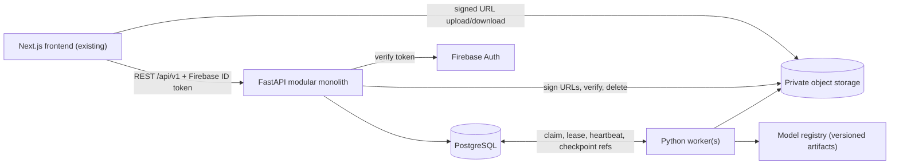
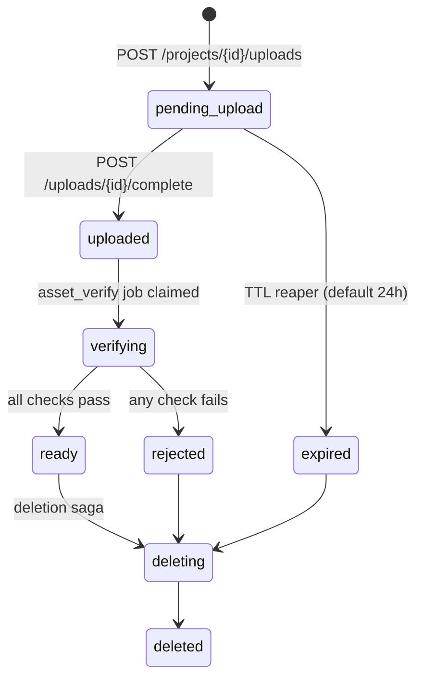
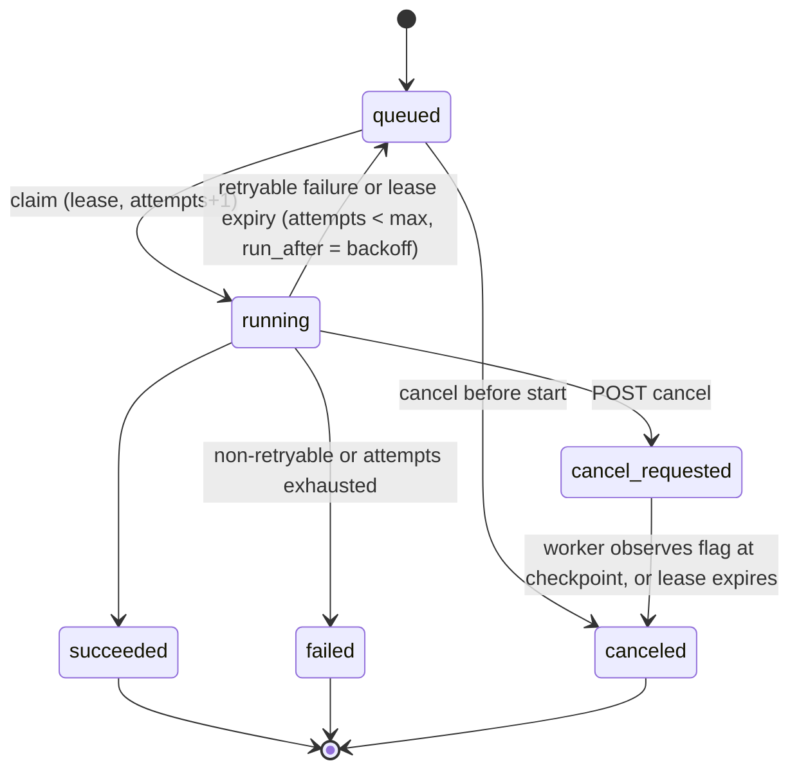
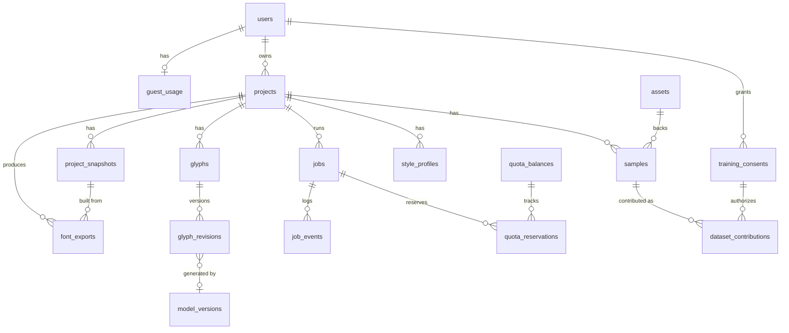

# Penforge — Codex Engineering Context (Backend, ML, Database, Infrastructure) — Consolidated v3

> **Single-file authoritative handoff, updated 2026-10-19.** This is the user's original comprehensive v2 document **preserved in full**, with all subsequently finalized `/grill-me` decisions integrated **above** it. It is not a replacement or a second standalone supplement. The existing frontend is already being implemented; **do not redesign or restructure it**.
>
> **Read order:** Part A (newer architecture decisions, integration contracts and reconciliation) → Part B (complete original v2 implementation specification). Later explicit `[FINAL]` decisions in Part A refine earlier choices; Part B remains binding wherever not explicitly refined. `[PROPOSED]` is an implementation suggestion, `[PENDING]` is unresolved, `[MEASURE]` requires empirical validation.
>
> **Important:** Original v2 status lines and its open-question table are preserved as historical baseline. The newer decision register in Part A supersedes their *decision counts*, not the original technical requirements. Do not treat an older "pending" label as overriding a later explicit finalized decision; do not treat newer design-level decisions as selecting unverified providers.

## Part A — Finalized architecture decisions and typed integration contracts (added above v2)

## 0. Authority, status and conflict resolution

- **[FINAL]** Product-owner decisions. Must be preserved unless explicitly superseded.
- **[PROPOSED]** Detailed defaults intended for implementation; validate against the repository and v2, and document deviations.
- **[PENDING]** Cannot honestly be selected until tests, benchmarks, current provider terms, or frontend inspection are complete.
- **[MEASURE]** No numeric claims or quality gates may be treated as production-ready until measured on writer-disjoint, script/style-specific validation sets.

**Order of interpretation:** (1) later explicit [FINAL] choices in this supplement override directly conflicting earlier *implementation preferences*, (2) v2's foundational architecture, security/privacy and product constraints remain binding, (3) proposals are not product commitments, (4) missing facts stay pending. Update `docs/decisions/` with an explicit supersession record, not silent edits to v2.

### Critical reconciliations

1. **Accuracy-first supersedes lightweight-first model selection [FINAL].** v2's default lightweight CPU inference remains an *eligible* method when it meets the same validated quality gate; it must not win solely on speed or cost. An advanced model may take longer, with honest progress and ETA. A slow model is not automatically more accurate.
2. **Self-hosted worker availability [FINAL addition] versus cloud-only foundational availability [FINAL v2].** Cloud + self-hosted is an allowed hybrid. However, v2 requires the foundational English workflow to be publicly available without depending on a continuously running personal Mac/desktop. Therefore **self-hosted machines are optional advanced-capacity workers, not the sole prerequisite for the English foundation**. If this cannot be achieved within actual free-tier limits, record an unresolved deployment feasibility issue; never claim the ₹0 target is proven or silently weaken the v2 requirement.
3. **Guided natural-writing calibration is the preferred product flow [FINAL later], while structured English template extraction remains the dependable M1 production foundation [FINAL v2].** Implement contracts and adaptive prompts now; gate unconstrained natural/cursive extraction by benchmarks. Do not imply v1 can accurately split every connected word.
4. **Advanced cursive features are a target, not a validated M1 capability.** v2's `calt`/alternates spike and milestone gates remain; GSUB/GPOS shaping requires independent tests. Devanagari R&D starts in parallel; no production claim until validated.
5. **No new frontend specification.** The API may expose ranked candidates, progress/ETA, alternatives and review status. The existing frontend chooses visual presentation, including whether it uses a linear or circular progress indicator.
6. **Final four integration contracts are design-level decisions; field names below are [PROPOSED] until reconciled with v2 and actual frontend.**

## 1. Finalized decision register — all later /grill-me choices

| ID | Status | Decision | Consequence |
|---|---|---|---|
| IC-01 | [FINAL] | Versioned canonical structured Bézier glyph JSON | One editable vector source for browser SVG and FontTools; explicit coordinate frame, metrics, multi-contour support, validation |
| IC-02 | [FINAL] | Versioned normalized browser stroke document | Preserve ordered strokes, timing and optional pen metadata, immutable raw capture and non-destructive revisions; derive Bézier outlines |
| IC-03 | [FINAL] | Versioned, script-aware printable template manifest | PDF generator and OpenCV extractor consume identical page geometry, marker, cell and Unicode mapping |
| IC-04 | [FINAL] | Progressive Latin coverage | 52 core letters; 95 printable ASCII for complete English v1; extended Latin later; valid partial export with truthful warnings |
| CAL-01 | [FINAL] | Guided passage + adaptive targeted completion | Preferred calibration starts with natural handwriting; isolated templates remain reliable fallback |
| CAL-02 | [FINAL] | Adaptive initial length | Start with 2–3 optimized sentences, then request only informative extra words, sentences or isolated glyphs |
| CAL-03 | [FINAL] | Ranked glyph candidates | Best **validated** authentic candidate first; alternatives accessible on request; user choice persists; uncertainty prompts resampling |
| ML-26 | [FINAL] | Modular hybrid multilingual architecture | Shared preprocessing/contracts, script/style-aware routing, specialized recognizers/extractors/shapers when needed |
| ML-27 | [FINAL] | Context-aware cursive representation | Glyph variants, authentic joining, selected ligatures, OpenType substitution/positioning and script-specific shaping |
| ML-28 | [FINAL] | Evidence-first hybrid generation | Authentic samples first; geometric/style-conditioned generation optional and clearly labeled; explicit approval; immutable originals |
| ML-29 | [FINAL] | Hybrid per-project style adaptation | Deterministic measurements and reuse first; shared conditioned models if validated; per-user fine-tuning research only |
| ML-30 | [FINAL] | Multi-dimensional quality evaluation | Independent recognition, segmentation, style, cursive, script shaping, export metrics and human evaluation; per-script/style gates |
| ML-31 | [FINAL] | Evidence-based uncertainty | Use visual evidence, calibration alignment and language context; preserve hypotheses; never let plausible words overwrite observed shapes |
| ML-32 | [FINAL] | Accuracy-first model selection | Quality gate first; time/cost secondary; no downgrade to weaker model to meet ETA |
| OPS-07 | [FINAL] | Real work progress + honest ETA | Durable jobs report stages and completed units; benchmark-derived remaining-time ranges; unknown ETA permitted |
| OPS-08 | [FINAL] | Free cloud + optional self-hosted advanced workers | Shared queue/protocol, no mandatory paid inference; v2 cloud-independent foundational English condition preserved |
| OPS-09 | [FINAL] | Checkpointed recovery with quality safeguards | Immutable validated outputs, bounded retry, lease fencing, resume, alternative equally validated methods, preserve partial work |
| IC-05 | [FINAL] | Immutable versioned ML result artifacts and controlled promotion | Model/input provenance, hashes, schema validation, ranked evidence; backend controls active revisions; approved glyphs never silently replaced |

## 2. System boundaries and ownership

**[FINAL]** Keep v2's Next.js frontend, Firebase Auth, FastAPI modular monolith, PostgreSQL/Alembic, private object storage adapter, PostgreSQL durable queue, independent Python ML/font workers, FontTools and HarfBuzz. No new Redis/Celery/broker requirement. `/api/v1` REST and OpenAPI-generated TS client remain the integration method.

**[PROPOSED]** Responsibilities:

- **Frontend (existing):** existing capture/upload/editor/preview flows; consumes typed status/candidate/coverage APIs. Inspect current components and data shapes before modifying adapters. No layout or design tasks in this handoff.
- **FastAPI:** auth, ownership, quotas, sample/template issuance, signed upload verification, job creation, status/ETA, candidate registration, review/approval, revisions, immutable export snapshots, privacy/deletion.
- **ML/CV worker:** validated preprocessing, script/style identification, OCR/sequence alignment, extraction, vectorization, candidate ranking, uncertainty evidence, optional reconstruction/generation; writes immutable staged artifacts and checkpoint refs. Never directly mutates active project glyphs.
- **Font engine:** deterministic glyph-to-font compilation, cmap/metrics, optional GSUB/GPOS, shaping tests, export validation; no model-training dependency.
- **PostgreSQL:** authoritative metadata and state transitions; job leases, review state, provenance, version pointers and hashes. No raw handwriting/font binary blobs.
- **Private object store:** immutable source captures, normalized intermediates when needed, candidate/result manifests, font exports and checkpoints with scoped references.

### End-to-end lifecycle [PROPOSED]

`upload/digital capture → immutable source asset → sample registration → durable analyze job → image/sequence assessment → script/style route → extract candidates + evidence → immutable result manifest → backend schema/hash/ownership validation → candidate registration → recommended rank + alternatives → user verification/selection or adaptive prompt → glyph revision/snapshot → export job → FontTools/HarfBuzz/validators → immutable font artifact`.

No background processing job can promote an ML-generated glyph without the explicit approval transition.

## 3. Integration contract IC-01: canonical glyph outline

**[FINAL semantics]** Schema-versioned, deterministic Bézier geometry, multiple contours, line/quadratic/cubic segments, explicit font-space units and metrics, reversible SVG preview adapter and FontTools compiler adapter, no loss of user edits. Existing v2 `glyphs.codepoints int[]`, `glyph_revisions.outline_inline jsonb <=32 KB` or `outline_asset_id`, and `metrics jsonb` are preserved.

**[PROPOSED illustrative JSON]** This is *not* a frozen public API until frontend reconciliation:

```json
{
  "schema_version": 1,
  "units_per_em": 1000,
  "coordinate_system": {"origin": "baseline", "x_positive": "right", "y_positive": "up"},
  "codepoints": [97],
  "metrics": {"advance_width": 530, "left_side_bearing": 40},
  "contours": [
    {"closed": true, "start": {"x": 110, "y": 0}, "segments": [
      {"type": "cubic", "c1": {"x": 70, "y": 130}, "c2": {"x": 75, "y": 410}, "to": {"x": 250, "y": 420}},
      {"type": "quadratic", "c": {"x": 400, "y": 420}, "to": {"x": 420, "y": 210}},
      {"type": "line", "to": {"x": 110, "y": 0}}
    ]}
  ]
}
```

**Validation [PROPOSED]:** reject NaN/Inf, unknown segment types, impossible/over-budget nodes, malformed codepoints, open contours where filled outlines are required, unsupported schema versions, and outlines exceeding configurable geometric bounds. Explicitly validate closure, winding/hole handling, overlapping contours, empty space glyph, metrics, and stable serialization. Do not assume all glyphs fit within `[0, em]`; descenders/overshoots are valid. `codepoints` may represent sequences for contextual or script-specific glyphs; distinguish cmap-mapped base glyphs from GSUB-only sequence/variant glyphs. `outline` and `outline_asset_id` are mutually exclusive when updating a revision. Generate deterministic content hashes from canonical serialization.

**Adapters [PROPOSED]:** canonical → SVG (`viewBox` y-axis transform); SVG editor → canonical with explicit coordinate transform; canonical → fontTools `TTGlyphPen`/`T2CharStringPen` as format demands; quadratic/cubic conversion must preserve tolerance and not silently change outlines. Store units and conversion precision in versioned config. Keep TTF/OTF outline technology explicit; do not label a font valid merely because it has the correct file extension.

## 4. Integration contract IC-02: browser stroke capture

**[FINAL semantics]** Raw stroke samples are distinct from font outlines. Ordered strokes, normalized coordinates, timing relative to capture, optional pressure/tilt/pointer metadata, explicit origin/axis, and non-destructive edit operations. Raw source remains immutable; edited versions are new derived revisions. No fabricated pressure data.

```json
{
  "schema_version": 1,
  "coordinate_system": {"origin": "top_left", "x_positive": "right", "y_positive": "down", "normalized": true},
  "capture_size_px": {"width": 800, "height": 600},
  "strokes": [
    {"stroke_id": "s1", "pointer_type": "pen", "points": [
      {"x": 0.2, "y": 0.3, "t_ms": 0, "pressure": 0.4},
      {"x": 0.23, "y": 0.34, "t_ms": 12, "pressure": 0.5}
    ]}
  ],
  "operations": []
}
```

**[PROPOSED]** Missing optional `pressure`, `tilt_x`, `tilt_y`, `twist` is `null`/absent, not inferred as observed data. Validate coordinates 0–1, nondecreasing per-stroke timestamps, finite values, point limits, stable IDs, supported edit operations, safe erasure geometry. Keep derived operations in a revision graph or immutable operation log. Conversion to outline records algorithm/model version, tolerance, coordinate transform and parent source hash. Use the same ownership, retention, deletion and consent controls as photographs.

## 5. Integration contract IC-03: shared handwriting template manifest

**[FINAL semantics]** Printable generator and OpenCV extractor use the **same immutable versioned manifest**; physical dimensions, page index, fiducial marker geometry, machine-readable page identity, guide geometry, extraction regions, script and Unicode mapping are authoritative. Never place user IDs, private project IDs or tokens in printed QR payloads.

```json
{
  "schema_version": 1,
  "template_id": "penforge-latin-basic",
  "template_version": "1.0.0",
  "script_code": "Latn",
  "page": {"size_mm": [210, 297], "index": 0},
  "markers": {"type": "aruco", "dictionary": "DICT_4X4_50", "items": [
    {"id": 0, "center_mm": [12, 12], "size_mm": 8},
    {"id": 1, "center_mm": [198, 12], "size_mm": 8},
    {"id": 2, "center_mm": [198, 285], "size_mm": 8},
    {"id": 3, "center_mm": [12, 285], "size_mm": 8}
  ]},
  "page_identity": {"encoding": "qr", "public_payload": "penforge-latin-basic:1.0.0:0"},
  "cells": [
    {"cell_id": "A-001", "codepoints": [65], "rect_mm": [20, 40, 24, 28], "guide_id": "latin-cap"}
  ],
  "guides": [{"id": "latin-cap", "baseline_offset_mm": 22}],
  "extraction": {"margin_mm": 1.5, "min_markers": 3}
}
```

**[PROPOSED]** Example marker coordinates are illustrative and require printability and detection tests. The QR payload identifies only public template/version/page; verify manifest digest on server, do not trust QR contents as authorization. Marker ordering, printable quiet zones, calibration transform, cell overlaps, guides, DPI scaling, and capture distortions must be tested. Reject mismatched versions and unknown templates with typed recovery guidance. Store manifest hash with sample and worker result; ensure archived versions remain accessible while referenced by active jobs. `samples.source_type` values from v2 (`template_scan`, `template_photo`, `freeform_photo`, `canvas_drawing`) remain compatible. Natural-passage templates may define text-line regions with expected Unicode sequences instead of isolated cells, but **do not assume reliable per-character segmentation**.

## 6. Integration contract IC-04: Unicode coverage and export

**[FINAL]** Core Latin set: U+0041–U+005A (26 uppercase) plus U+0061–U+007A (26 lowercase) = **52**. Complete English v1: **95 printable ASCII codepoints U+0020–U+007E** = 52 letters + 10 digits + 32 punctuation/symbols + 1 space. Extended Latin is a later capability, not an implied M1 guarantee.

**[FINAL]** Permit technically valid partial font exports with accurate coverage warnings and no invented missing glyphs. An absent glyph must not be represented as an approved user-authentic glyph. Generated candidates need explicit approval before inclusion as such. A complete English v1 badge/status requires all 95 mapped characters plus successful export validation. `space` U+0020 has an advance metric and typically no drawn outline; `.notdef` is a required fallback glyph, not counted among the 95. Additional required font tables/metadata depend on format and validator.

**[PROPOSED]** Coverage engine computes sets of `observed`, `eligible`, `recommended`, `user_approved`, `generated_pending`, `missing`, `rejected`, `exported` per script, codepoint/sequence and feature. Do not conflate recognition confidence with approval or glyph readiness. Mark typographic ligatures and contextual forms separately from base cmap coverage. For Devanagari, coverage requires shaping tests of clusters, matras and conjuncts, not just counting codepoints. Export manifest includes actual supported cmap and unresolved coverage warnings.

## 7. Calibration: guided passage and adaptive completion

**[FINAL]** Preferred path is **2–3 carefully optimized sentences** written in natural handwriting, followed by targeted additional words/sentences or isolated characters. Structured isolated templates remain the production-safe fallback. Optimize for script coverage, useful repeats, distinct letter contexts, and information gain; avoid requiring all 95 glyphs to be written before the first partial export.

**[PROPOSED]** Calibration definition is versioned `{calibration_id, version, script_code, prompt_text, target_codepoints, target_sequences, expected_regions, objective_weights, minimum_sample_policy}`. Treat prompt text as **known alignment context, not ground truth of what the person actually wrote**. Use CTC/sequence OCR or equivalent only if validated; visually verify mismatches. Stage the collection plan:

1. Record capture type, orientation, resolution, script/style hypothesis, expected prompt/version, source hash.
2. Quality-check legibility, clipping, motion blur, shadows, marker/line detection and language/script suitability; return actionable retake reasons when needed.
3. Align lines/words to expected text; preserve competing hypotheses and confidence calibration.
4. Identify observed character and context coverage; segment only where supported by measured quality. Never turn an uncertain word alignment into a confidently assigned glyph.
5. Extract multiple authentic candidates with provenance and independent scores for OCR, segmentation, vector quality and personal-style fit.
6. Rank eligible candidates; default recommendation is the strongest validated authentic sample. Keep alternates retrievable on request; do not auto-promote pending generated glyphs.
7. Choose targeted next prompts maximizing expected coverage/quality improvement per writing effort; prefer isolated characters when joined handwriting cannot be reliably segmented.
8. Repeat until user chooses to export partial coverage or meets the script's defined completeness/quality target.

**[PROPOSED]** Example initial prompt can include `The quick brown fox jumps over the lazy dog.` plus additional sentences chosen through an offline optimizer. **No final optimized boilerplate text has been benchmarked or approved**; do not claim the example is optimal. Track expected versus observed coverage and repeated-context diversity. Optimize on writer-disjoint corpora and handwriting styles, not just English character frequency.

### Candidate ranking and user control [FINAL]

- Initial results expose the highest-quality eligible authentic candidate for each codepoint/sequence; full alternatives are separately retrievable. Ranking is evidence-based, not solely OCR probability.
- A user-selected/edited glyph remains the active revision unless an explicit user action changes it. Reprocessing creates new immutable candidates and comparison sets, never mutates existing approved revisions or exports.
- When evidence is insufficient, mark `needs_review`/`needs_better_input` and ask for a targeted sample. Preserve uncertain connected regions as source evidence.
- Geometric reconstruction and style-conditioned generation are optional proposed candidates; identify them as synthetic, attach model/algorithm provenance and source evidence, and require explicit approval.

## 8. Modular multilingual / cursive ML architecture

**[FINAL]** Shared preprocessing and canonical result/outline contracts; script/style-aware routing to interchangeable specialized components. Latin print, Latin cursive, mixed writing and Devanagari require separate validation. Shared multilingual recognition is allowed if evidence supports it; no assumption that one model is universally best.

**[PROPOSED]** Stable plugin protocols:

```python
class ScriptStyleDetector(Protocol):
    def infer(self, source_ref, context) -> DetectionResult: ...

class HandwritingRecognizer(Protocol):
    def recognize(self, source_ref, script_code, context) -> RecognitionResult: ...

class GlyphExtractor(Protocol):
    def extract(self, source_ref, alignment, context) -> CandidateSet: ...

class CandidateGenerator(Protocol):
    def propose(self, approved_references, target, context) -> CandidateSet: ...

class FontShaperValidator(Protocol):
    def validate(self, font_ref, script_code, corpus_ref) -> ShapingReport: ...
```

**[FINAL]** Accuracy-first selection: compare methods on the *same* writer-disjoint script/style benchmarks and quality dimensions; select highest validated expected fidelity and reliability for the input class. Runtime and compute determine feasibility/scheduling, **not permission to quietly lower quality**. If suitable resources are unavailable, queue/wait or return an honest unsupported/needs-intervention state. Never silently downgrade to an inferior model because of an ETA. Do not interpret model softmax as calibrated certainty without calibration tests.

**[FINAL]** Cursive representation supports observed isolated/base glyphs, contextual beginning/middle/end and other variants where appropriate, authentic joining geometry, selected ligatures, and OpenType substitutions/positioning. The representation must not assume every script follows Latin joining rules. Devanagari shaping uses appropriate GSUB/GPOS and HarfBuzz tests for reordering, matras and conjuncts; script-specific features and shaping sequences are independently validated.

**[PROPOSED]** Store contextual glyph identity separately from Unicode mapping: `{glyph_id, codepoints, variant_index, context_rule_id?, source_candidate_id, outline_revision_id, approved_state}`. Build GSUB feature rules from explicit, tested mappings; no arbitrary substitution of base glyphs. Do not enable optional `calt` or ligatures if a shaping spike fails. Verify behavior across representative text, platforms, renderers, and text runs; ensure fallback when features are disabled. Multi-glyph joining may require anchor/positioning geometry, not just substitutions.

**[FINAL]** Personal adaptation: measured slant, stroke weight, ascender/descender proportions, widths, spacing, rhythm, authentic alternates and optional embeddings. Shared style-conditioned generation may be used if validated; per-user fine-tuning is **research only**, not a runtime dependency. Separate training consent from using a person's handwriting to create their own font.

## 9. Integration contract IC-05: immutable ML result artifact

**[FINAL]** Worker results are immutable, versioned, content-hashed and traceable to inputs, template, script/style model and algorithm versions. Worker writes results; backend validates and registers candidates. **No worker directly sets `glyphs.active_revision_id` or overwrites approved data.** This holds across model upgrades, retries and worker types.

**[PROPOSED]** Manifest stored in private object storage (large geometry as referenced child artifacts):

```json
{
  "schema_version": 1,
  "artifact_type": "penforge.ml_result",
  "job_id": "job_uuid",
  "attempt_id": "attempt_uuid",
  "stage": "candidate_extraction",
  "input": {"sample_ids": ["sample_uuid"], "source_hashes": ["sha256:..."], "template_manifest_hash": "sha256:..."},
  "pipeline": {"script_code": "Latn", "style": "cursive", "model_id": "latin-extractor", "model_version": "model-version", "model_hash": "sha256:...", "algorithm_version": "1"},
  "candidates": [
    {"candidate_id": "candidate_uuid", "codepoints": [97], "rank": 1, "origin": "authentic_extraction", "outline_asset_hash": "sha256:...", "evidence": {"recognition": null, "segmentation": null, "style_fidelity": null, "outline_validity": "pass"}, "review_status": "pending"}
  ],
  "quality_report_asset_hash": "sha256:...",
  "artifact_hash": "sha256:..."
}
```

**[PROPOSED]** Hash the canonical serialized body *excluding* `artifact_hash` to avoid circularity; record cryptographic hash and byte size for referenced children. The object key itself is not proof of authenticity. Backend must validate source ownership, expected job/attempt, worker lease fencing, compatible schema/model, matching input hashes, referenced child checksums, size/geometry limits, status transitions and quota before registration. Prefer atomic publication: stage blobs → validate → publish immutable manifest → commit DB reference under valid fencing token. Crash between object publication and DB commit is handled by orphan reconciliation. Retry with identical idempotency key/hash returns the same registered artifact; hash mismatch is an error.

**[PROPOSED]** Separate `recognition_score`, `segmentation_score`, `outline_quality`, `style_fidelity`, `model_uncertainty` and human-review status. Unmeasured scores are `null`, never invented. Keep competing OCR hypotheses and source crop refs in private evidence assets; prohibit private image content in public logs/events. A generated candidate's `origin` must distinguish `authentic_extraction`, `geometric_reconstruction`, `style_conditioned_generation`, and `manual_drawing`.

### Promotion state machine [PROPOSED implementation of FINAL constraint]

`extracted → registered_pending → eligible/requires_review/rejected → user_selected → revision_created → active`; generated/reconstructed candidate must pass `explicitly_approved` before `revision_created`. Rejected candidates remain auditable per retention policy, not in active font. Backend checks `base_revision_id`/ETag to prevent races. An approved glyph is immutable as a revision; changing selection creates a *new* revision and never edits prior snapshots. A new model result is a sibling candidate set, not an in-place replacement. If a user has never explicitly selected an authentic glyph, a policy may expose a *recommended preview* but must distinguish recommendation from committed approval.

## 10. APIs and worker contract additions (all route names [PROPOSED])

**Do not invent a new API if v2 already has an equivalent route.** Keep `/api/v1`, Pydantic/OpenAPI, generated TS client, ownership-scoped access, `Idempotency-Key`, typed errors, optimistic concurrency. Preserve v2's `PATCH /projects/{id}/glyphs/{glyph_id}` with `base_revision_id`, `outline | outline_asset_id`, `metrics`, `action` where present.

| Capability | Suggested API | Notes |
|---|---|---|
| Template inventory | `GET /api/v1/templates?script_code=Latn` | Public metadata, manifest digest and version |
| Calibration definition | `GET /api/v1/calibrations/{id}` | Immutable text/version, script, expected regions |
| Start sample analysis | Existing sample/job endpoint; optional `POST /api/v1/projects/{id}/analysis-jobs` | Job payload contains IDs, no binary data |
| Job status | `GET /api/v1/jobs/{id}` | State, stage, real progress, ETA and reason |
| Live status | Existing job SSE endpoint with polling fallback | Resume `Last-Event-ID`, no private content in events |
| Coverage | `GET /api/v1/projects/{id}/coverage` | Core/ASCII/extended sets and warnings |
| Recommended glyph | Existing glyph endpoint plus recommendation fields | Candidate provenance and review state |
| Alternatives | `GET /api/v1/projects/{id}/glyphs/{glyph_id}/candidates` | Paginated ranked candidates; no bulk blobs |
| Candidate selection | `POST /api/v1/projects/{id}/glyphs/{glyph_id}/select-candidate` | Idempotent, revision-aware, explicit approval for synthetic origins |
| Next prompt | `GET /api/v1/projects/{id}/calibration/next` | Targeted words/characters and reason codes |
| Export | Existing export job endpoints | Immutable snapshot; warnings; format validation |

**[PROPOSED]** Status envelope example:

```json
{
  "job_id": "job_uuid",
  "status": "processing",
  "stage": "glyph_validation",
  "progress": {"completed_units": 60, "total_units": 100, "percentage": 60, "basis": "validated_units"},
  "eta": {"estimated_remaining_seconds": null, "range_seconds": null, "confidence": "insufficient_data", "benchmark_profile_id": null},
  "quality_policy": "accuracy_first",
  "requires_user_action": false,
  "result_artifact_id": null
}
```

**[FINAL semantics]** A percentage reflects real stage units, not a time guess; if total units expand during deeper processing, explain that the denominator changed or expose indeterminate progress. Do not promise monotonic percentages across replans unless stage weights/total work are frozen. ETA may be absent, revised or shown as a range; benchmarks must match script/style/model/hardware/input size and queue waiting. Distinguish queued time, active processing and awaiting user review. SSE and polling must deliver equivalent state semantics.

### Version compatibility [PROPOSED]

- Separate versions for REST/OpenAPI, canonical outline, stroke document, template manifest, calibration definition, ML result artifact, job payload and model registry entry. Do not conflate them.
- A worker advertises supported payload/result schema versions and scripts; claim logic filters incompatible jobs. Keep N-1 payload support for at least one release cycle per v2.
- Never reinterpret an old template's physical coordinates using a new manifest. Pin each sample to immutable `template_id`, `template_version`, `manifest_hash`.
- Every result records model checksum and preprocessing/algorithm version; upgraded model runs create new result IDs and comparisons.
- Reject unsupported versions with typed errors, never best-effort silent reinterpretation.

## 11. Data persistence and migration mapping

**[FINAL]** Retain v2's PostgreSQL schema and state machines. Do **not** replace the v2 DDL without reviewing it. In particular, keep `glyphs.codepoints int[]`, `glyph_revisions.outline_inline`/`outline_asset_id`/`metrics`, `samples` template metadata and source type, existing job tables/leases/checkpoints, `font_exports` immutability and consent/deletion structures.

**[PROPOSED additions; first inspect current v2 tables and code]:**

| Logical data | Suggested persistence | Invariant |
|---|---|---|
| Template manifests | Immutable JSON assets + metadata/version/hash | Same hash used by generator/extractor |
| Calibration definitions | Immutable JSON assets + script/version | Prompt text and region mapping reproducible |
| Stroke documents | Source assets + revision references | Raw capture immutable; derived edits linked |
| Sample alignment | Per-sample evidence artifact and model refs | Competing hypotheses retained privately |
| Candidate sets | `ml_result_artifacts` metadata + private manifest | Unique `(job_id, stage, content_hash)` where appropriate |
| Glyph candidates | Existing candidates table if present; otherwise new `glyph_candidates` | Origin, rank, evidence refs, review state, immutable geometry |
| Style profiles | Existing style module/table or new versioned record | Profile derived from approved references; no training consent assumption |
| Progress estimates | Job stage counters + benchmark profile refs | ETA may be null; no fake percent |
| Context rules | Versioned script feature rule records | Never conflate base cmap and GSUB substitutions |
| Coverage | Derive or materialize per project/snapshot | Recompute after revisions; export snapshot immutable |

**[PROPOSED]** Migration rollout: additive nullable columns/tables → dual read (if needed) → backfill from existing data → worker/API compatibility tests → tighten constraints only after migration verification. Foreign keys/unique indexes enforce idempotency and revision protection. Audit metadata never contains handwriting text/images. Implement owner-scoped candidate/result retrieval; references alone never grant authorization.

## 12. Durable execution, recovery, progress and infrastructure

**[FINAL]** Use v2's PostgreSQL `FOR UPDATE SKIP LOCKED` queue, leases, heartbeats, attempt fencing, checkpointing, bounded retries, cancellation and idempotent stages. Results/checkpoints are immutable and hash-verified before reuse. Preserve partial successful stages on crashes and resume from last valid checkpoint. Worker loss is not handwriting-quality failure.

**[PROPOSED]** Suggested stage graph (stage names not final): `asset_verify → normalize → detect_script_style → align_template_or_text → recognize → segment → extract → vectorize → quality_rank → propose_optional_missing → register_result → user_review_gate → font_compile → validate_export → finalize`. Record input hashes and dependency hashes in each checkpoint key; a changed template/model/config invalidates affected downstream stages. Each stage publishes atomically with fencing. On failure classify `retryable_infra`, `input_quality`, `model_incompatible`, `resource_unavailable`, `quality_gate_failed`, `security_invalid`, `canceled`, `poison_job`. Never retry a permanent invalid input endlessly. Preserve earlier stage artifacts until retention/deletion policy allows cleanup.

**[FINAL]** If one model fails, another is allowed only if validated to meet the same or better required quality for that input class. If no qualified model is available, queue or return a truthful actionable state; **never silently substitute a less accurate output**. Accuracy-first does not mean unlimited cost: enforce global resource ceilings and reject/defer work rather than causing unbounded spending.

**[FINAL]** Cloud plus optional self-hosted advanced workers share the same protocol, model registry, schema and lease semantics. **The foundational English public flow cannot require an always-on personal machine**, as v2 explicitly states. Self-hosted workers must authenticate as services with least privilege; they should not have unrestricted cross-user data access beyond the scoped jobs they execute. If feasible, use job-scoped signed URLs or a controlled storage proxy. Treat network disconnect as lease expiration and recover safely.

**[PENDING]** Specific provider(s), free-tier eligibility, self-hosted worker availability/security design, hosting quotas, GPU access, actual cloud cost, and measured throughput. Do not assert that ₹0 is achieved without evidence. v2 Infra Q7–Q10 remain open; completing `/grill-me` for this *supplement* does **not** fabricate answers to the original v2 open infrastructure questions.

## 13. Evaluation, quality gates and release policy

**[FINAL]** Quality is multi-dimensional and assessed independently for Latin print, Latin cursive, mixed writing and each new script. Human validation supplements automated metrics. No invented overall accuracy number or single model confidence threshold is acceptable.

| Dimension | Metrics / checks [PROPOSED] | What it must not be confused with |
|---|---|---|
| Recognition | CER, character accuracy, top-k, calibration/ECE | Personal style fidelity |
| Alignment/segmentation | Region IoU, boundary F1, split/merge errors, correct glyph assignment | OCR word plausibility |
| Outline quality | Contour validity, geometry error, path complexity, raster comparison | Readability alone |
| Writer fidelity | Held-out same-writer visual comparisons, geometric feature errors, blinded human preference | Generic handwriting similarity |
| Cursive behavior | Joining discontinuities, contextual correctness, feature on/off tests, human legibility | Isolated glyph accuracy |
| Script shaping | HarfBuzz golden corpus, GSUB/GPOS and cluster coverage, font-engine validation | Unicode inventory count |
| Font export | FontTools structural tests, OTS where available, install/render checks, deterministic builds | File extension or successful ZIP |
| User burden | Resamples, manual corrections per glyph, first usable export | Latency alone |
| Operations | p50/p95 job/stage duration, peak RSS, queue age, recovery success, compute cost | ML quality |

**[MEASURE]** Benchmark datasets must have writer-disjoint splits, documented licenses, sample provenance, per-style/per-script partitions and adversarial camera/input conditions. Calibrate confidence against observed error rates; determine thresholds only after baseline experiments. Human reviewers compare generated text and authentic held-out handwriting, with blinded ordering and clear instructions. Test cursive joining and Devanagari shaping using text-run corpora, not only single characters. Record model/version/dataset/hardware and confidence intervals where appropriate. Production promotion requires no regression against agreed gates and rollback capability.

**[PROPOSED]** Quality release labels: `research_only`, `experimental_opt_in`, `production_validated`, `temporarily_disabled`. Per-module and per-script, not one blanket product label. No unsupported claims of accurate freeform cursive or production Devanagari.

## 14. Privacy, security and training consent

**[FINAL]** Handwriting is private by default. Creating one's own font is **not** permission to train global models. Explicit opt-in for training contributions; versioned consent and withdrawal; immutable original captures and revision lineage until authorized retention/deletion. Delete all applicable derived artifacts, checkpoint blobs, style embeddings, and dataset contributions per v2 deletion saga, subject to disclosed backup retention and honest limits of model unlearning.

**[PROPOSED]** Threat controls: validate upload bytes/magic/dimensions and sandbox decoding; reject oversized decompression bombs; verify ownership at every result/candidate endpoint; short-lived scoped URLs; content hashes; checksum-verified safe model formats; deny arbitrary model deserialization; rate/compute quotas and fair scheduling; redact tokens, signed URLs, raw images, prompt handwriting and source text from operational logs. QR template payloads contain only public version metadata. Worker-to-storage permissions are job scoped where supported. Test IDOR, forged job artifacts, hash mismatch, stale lease publication, candidate promotion races, deletion during in-flight processing and replay attacks.

## 15. Implementation plan for Codex — additive to v2 slices

**Do not reorder or replace v2's S0–S8 roadmap.** Add these tasks into the existing slices, subject to actual repository state:

| Existing v2 slice | Additive tasks [PROPOSED] | Acceptance evidence |
|---|---|---|
| S0 Foundations | Contract registry, schema-version policy, read-only frontend type audit, ADR for accuracy-first reconciliation | OpenAPI + JSON schema checks; no frontend redesign |
| S1–S2 Auth/projects | Ensure candidates/style/calibration metadata owner-scoped; guest quotas remain authoritative | Cross-user negative tests, guest limit preserved |
| S3 Upload/jobs | Store raw strokes and original scans immutably; template identity and source hash | Content verification, replay, deletion and version pinning tests |
| S4 English extraction | Manifest generator/extractor parity, Latin 52/95 coverage, ranked authentic candidates, adaptive prompts contracts, optional passage alignment research behind feature flag | Synthetic template golden set, rank stability, fallback prompts, truthful coverage |
| S5 Font export | Canonical Bézier adapters, partial coverage warnings, `.notdef` and space, immutable snapshots | FontTools/OTS/render tests for TTF/OTF/WOFF2 |
| S6 Durable recovery | Versioned result manifests, checkpoint validation, stage counters, benchmark ETA, lease-fenced backend registration | Kill-worker/resume test, stale writer blocked, ETA unknown handling |
| S6b Privacy/deletion | Delete raw strokes, model-derived embeddings, candidates, manifests and checkpoints | Crash-recovery deletion tests; no leaked content |
| S7 Personalization | Style measurements, evidence-first optional generation, contextual variants/ligatures after shaping spike, human evaluation | Generated candidates cannot auto-activate; shaping regression suite |
| S8 Devanagari | Script-aware prompt manifests, akshara/matra/conjunct handling, GSUB/GPOS shaping | HarfBuzz corpus tests; explicit readiness gate |

### Required acceptance tests [PROPOSED]

1. A tilted/rotated printed Latin sheet is rectified using the **pinned** manifest and yields correctly mapped codepoints; wrong manifest version is rejected.
2. Stroke capture with missing pressure round-trips without inventing pressure; original source hash remains unchanged after editing.
3. Canonical glyph JSON round-trips to SVG/FontTools within declared tolerance; closed contours, holes and descenders behave correctly.
4. A 52-letter-only project exports a technically valid partial font with warnings; a 95-character project passes the complete ASCII inventory check; space is not treated as a handwritten outline.
5. Passage OCR ambiguity does not silently assign the wrong glyph; known prompt alignment never overrides visual evidence.
6. Candidate list ranks eligible authentic samples; alternatives are retrievable; selected/approved glyph survives new model results and retried jobs.
7. Generated/reconstructed glyph cannot become active without explicit approval, including under concurrent requests and DB-level protection.
8. Model v2 reprocessing creates a new result artifact with provenance; old exports and user revisions remain byte-identical.
9. A worker killed after two pages resumes page three from validated checkpoints; stale lease holder cannot publish.
10. Worker unavailability reports queued/unknown ETA honestly and does not fabricate progress; SSE and polling agree.
11. Self-hosted worker compromise simulations cannot access unrelated user assets; signed URLs and logs contain no leaked secrets.
12. Print and cursive benchmarks report separate results; a model upgrade that harms fidelity is blocked even if OCR accuracy rises.
13. Cursive contextual rules pass shaping tests; Devanagari script rules pass cluster/reordering/matra/conjunct tests before production label.
14. Account deletion during a queued/running job cancels access, prevents new artifact publication, and completes cleanup/reconciliation.
15. Existing frontend type-checks against generated API client with **minimal integration changes only**; no UI redesign is part of acceptance.

## 16. Unresolved items — do not silently decide

1. **[PENDING]** Infra Q7 (environments, secrets, service-to-service identity), Q8–Q10 (not defined in v2), provider selections, actual free-tier viability and operational backups.
2. **[PENDING]** Inspect actual frontend for wire casing (`snake_case`/`camelCase`), editor geometry, current stroke structure, upload lifecycle, job status semantics, and candidate data; reconcile without redesign.
3. **[PENDING]** Choose exact calibration boilerplate after coverage/segmentation benchmarking; decide localized script prompts and reading level.
4. **[PENDING]** Select and benchmark concrete OCR, cursive segmentation, style-conditioned generation and script detectors. This handoff does not invent specific winning models.
5. **[PENDING]** Measure quality thresholds, candidate ranking weights, ETA profiles, stage weights, resource caps, and safe concurrency.
6. **[PENDING]** Exact template fiducial placement, print scaling, guide colors, marker dictionary and detection limits; the example is illustrative.
7. **[PENDING]** Optional OpenType `calt` cycling and joining feature behavior; requires actual font-engine spike and validation.
8. **[PENDING]** Devanagari cluster inventory and production acceptance corpus; script-specific support cannot be inferred from Latin success.
9. **[PENDING]** Whether partial-export default recommendation can be auto-selected without an explicit user click; generated candidates **always** require explicit approval. Keep recommendation distinct from activation.
10. **[PENDING]** Exact JSON schema names, field casing, DB migration shape and endpoint routes until actual v2/current code review; proposed examples are implementation guidance.

## 17. Codex execution instructions / definition of done

1. Read v2 and current repo **before writing code**. Create a conflict/reconciliation matrix with source (v2 section vs later FINAL decision), resolution and affected files. No silent change to finalized constraints.
2. Inventory existing Next.js types/endpoints, preserve the frontend, and propose the smallest adapter changes required for integration. No new UI designs, layouts or styling.
3. Implement versioned Pydantic/JSON Schemas, generated TS types, schema compatibility tests and migrations before cross-service coupling. Distinguish `[FINAL]` semantics from `[PROPOSED]` field names.
4. Use immutable source and result assets, controlled candidate promotion, hash checks, ownership and consent everywhere. Enforce user-approved glyph protection at API/service/DB layers.
5. Keep structured English M1 working independently of advanced freeform/cursive models and optional self-hosted hardware. Advanced quality-first processing may queue, but must not silently degrade output.
6. Add benchmark fixtures and quality reports by script/style. Until validated, label models/capabilities experimental and leave ETA/thresholds unknown.
7. Implement reliable stage checkpoints, retries, fencing, cleanup, progress and honest ETA using v2 queue semantics. Never replace it with an in-memory job runner.
8. Produce an ADR for each reconciliation, a migration plan, test results, measured resource profile, and a list of unresolved questions. No provider or cost assertions without verification.
9. Complete the v2 roadmap slices and their acceptance criteria, plus §15 tests above. Do not mark production-ready solely on code compilation or a model's OCR accuracy.

### Suggested first Codex prompt

> Read `PENFORGE_CODEX_BACKEND_ML_INFRA_CONTEXT_v2.md` and `PENFORGE_CODEX_ARCHITECTURE_DECISIONS_SUPPLEMENT_v3.md` completely, then inspect the existing frontend code/types and current repository state. Do **not** redesign or rewrite the frontend. First produce a gap analysis and a reconciliation matrix (v2 FINAL vs later FINAL vs PROPOSED/PENDING), including the accuracy-first and optional self-hosted-compute constraints. Identify the smallest next vertical slice from the existing v2 roadmap, implement only that slice with versioned contracts, migrations and tests, and report benchmarks and unresolved decisions honestly. Never invent providers, quality thresholds, free-tier guarantees or model accuracy.

---

**End of additive supplement.** The original v2 engineering specification remains the base reference and should be supplied alongside this file to Codex.


---

## Part B — Original Penforge v2 engineering specification (preserved verbatim)

> **Historical baseline:** Everything below is the uploaded v2 text without edits. Use Part A for later decisions and any explicitly documented reconciliation.

# Penforge — Codex Engineering Context (Backend, ML, Database, Infrastructure)

> **Scope:** Backend, ML, database, storage, security, and infrastructure only. The frontend is already being implemented. Do not redesign it or replace its existing decisions. Integrate through typed, versioned contracts.
>
> **Status:** Backend 12/12 decisions finalized; ML 25/25 finalized; Infrastructure 1–6 finalized. Infrastructure 7–10 pending. Provider selection and performance benchmarks are **not yet completed**.
>
> **Document version:** v2 (expanded implementation spec). Sections 1–4 preserve the original decisions; sections 5–12 add implementable detail.

## 0. How to read this document

Every statement carries one of three statuses. Codex must respect them.

| Tag | Meaning | What Codex does |
|---|---|---|
| **[FINAL]** | Decided by the product owner. | Treat as a hard constraint. Never override silently. |
| **[PROPOSED]** | Recommended default added in v2 to make the spec implementable. | Implement it unless the decision log (section 12) overrides it. Record any change there. |
| **[PENDING]** | Unresolved (provider choices, benchmarks, numeric thresholds, Infra Q7–Q10). | Do **not** invent an answer. Build behind an interface, make it configurable, and list it in the decision log. |

**What changed in v2:** full backend module/contract spec (6), proposed PostgreSQL DDL with state machines and key SQL (7), stage-by-stage ML/font pipeline with model registry, evaluation, and Devanagari shaping tests (8), worker protocol (9), expanded test matrix (10), vertical-slice roadmap with acceptance criteria (11), and an open-decision log (12).

---

## 1. Non-negotiable product constraints [FINAL]

- Penforge converts handwriting into personalized, installable TTF, OTF, and WOFF2 fonts.
- **₹0 initial infrastructure target**, publicly accessible cloud deployment from day one. Do not depend on a continuously running personal Mac/desktop, paid GPU, or paid API for the foundational English workflow. Verify actual free-tier terms, billing prerequisites, resource limits, and availability before claiming a provider works at ₹0. Do not permit uncontrolled paid overages.
- **English/Latin production foundation first**; **Devanagari engineering and research proceed in parallel from the beginning**. Implement Unicode-aware, script-aware data and shaping. Do not claim Devanagari readiness until proper OpenType GSUB/GPOS and HarfBuzz tests pass.
- **Firebase Authentication**: anonymous guest identities, 3 guest creations, email/password and Google login, account linking and guest project claiming. Backend verifies Firebase ID tokens and enforces ownership and quotas server-side. Verify feature and plan compatibility.
- User handwriting is **private by default**. Model training contributions require separate, explicit opt-in. Support retention, withdrawal, provenance, deletion, and minimal audit records.
- Preserve originals, non-destructive glyph revisions, approved generated candidates, immutable font exports, and recoverable asynchronous jobs.
- Build for future selective paid scaling without a rewrite.

## 2. Architecture overview [FINAL]

1. Existing Next.js frontend talks to versioned `/api/v1` REST endpoints using an OpenAPI-generated TypeScript client; it sends Firebase ID tokens and uses signed upload/download flows.
2. **Modular FastAPI monolith** provides project, glyph, asset, job, export, consent, quota, and ownership operations. Lightweight Next.js/serverless endpoints may be used where useful, without duplicating authorization rules.
3. **PostgreSQL-first**, provider benchmark pending (Supabase and Neon are candidates). SQLAlchemy + Alembic. No binary handwriting or font files in the database.
4. **Private provider-independent object storage** behind a small adapter for uploads, downloads, metadata, and deletion. Provider pending; candidates include Supabase Storage and Cloudflare R2, subject to verification.
5. **PostgreSQL-backed durable job queue** with atomic claiming, leases, heartbeats, checkpoints, bounded retries, cancellation, and at-least-once processing. Python workers can be persistent or scheduled; runtime selected by benchmark.
6. **Python ML/font worker** uses CPU-first staged processing (OpenCV, tracing, small models, FontTools, HarfBuzz validation). Advanced inference is selective and benchmark-gated.
7. **CI/CD** via GitHub Actions, contract and integration tests, migration compatibility checks, lightweight observability, backup restore verification, staged releases, and rollback.



## 3. Finalized decisions

### 3.1 Backend — 12/12 [FINAL]

1. **Modular backend**: FastAPI modular monolith with independently deployable Python ML/font workers; hybrid lightweight serverless where beneficial. Avoid premature microservices.
2. **Identity**: Firebase anonymous guests (3 creations), email/password, Google, linking and project claiming. Verify Firebase ID tokens in FastAPI; internal UID mapping, server-side ownership, rate limits, abuse controls.
3. **Data**: Firebase Auth separate from benchmark-selected PostgreSQL (leading candidate), private object storage with portable interfaces. Minimize provider-specific code.
4. **Uploads**: Browser validation, signed direct-to-cloud uploads when supported, server ownership/size/type/content verification, resumability when supported, preserve originals, abandoned upload cleanup. Never trust client metadata alone.
5. **Jobs**: Durable database queue, checkpointed stages, worker leases/heartbeats, retry/backoff, cancellation, crash recovery, idempotency.
6. **Versions**: Autosaved working state, fine-grained glyph revisions, milestone snapshots, immutable exports, deduplicated assets, model provenance, rollback. Browser undo is separate from durable revision history.
7. **Sync**: Debounced REST autosaves, optimistic UI, local recovery drafts, revision-aware conflict detection, SSE where practical or adaptive polling; explicitly distinguish local-only, syncing, cloud-saved.
8. **Resource governance**: Rate limits, guest/user quotas, compute budgets, fair scheduling, global ceilings, bounded concurrency, graceful degradation, future paid tiers. Atomic quota reservations, release unused resources after cancellation/failure. Do not rely solely on billing alerts.
9. **Privacy**: Private storage, configurable retention, explicit independent training consent, contribution provenance, coordinated deletion across Firebase/database/storage/workers/checkpoints, minimal content-free audit records. Cancel jobs/revoke access before deletion. Withdrawal blocks future training and removes active dataset contributions where feasible; do not promise removal of influence from trained model weights. Provider backups expire under documented policy.
10. **API contracts**: Versioned REST (`/api/v1`), OpenAPI/Pydantic, generated TS clients, idempotency keys, consistent typed errors, async job endpoints, optimistic concurrency, independently versioned worker payloads. Add `/api/v2` only for genuinely breaking changes.
11. **DevOps**: GitHub Actions, lint/type/unit/integration/ML smoke/contract tests, staged releases, schema and job compatibility checks, health/queue/worker/usage monitoring, backups with restore drills, safe rollback. Never log handwriting or tokens.
12. **Deployment**: Adaptive multi-provider cloud, ₹0 public MVP target, CPU-first, strict caps, benchmark-driven hosting, optimize before spending, selectively scale bottlenecks to paid compute later. A free-tier solution is not yet proven.

### 3.2 ML — 25/25 [FINAL]

1. Two tracks: structured-template production foundation and progressive natural/freeform handwriting research.
2. Data from licensed public sources, synthetic samples, original curated data, and separately opted-in contributions; writer-disjoint splits and provenance.
3. Distinct components for recognition/extraction, missing-glyph generation, style learning/refinement.
4. Shared pretrained models + per-project style embeddings; selective fine-tuning only if benchmark-justified; user corrections as fallback.
5. Missing glyphs: generate candidates, attach confidence/quality, request targeted handwriting when needed, require explicit approval.
6. Cloud-first adaptive inference: lightweight browser preprocessing, cloud API and queued workers; heavier inference only when needed.
7. English first, parallel Devanagari; Unicode-first, script-aware representation.
8. One capture workflow supporting structured templates, natural handwriting/photos, and digital drawing.
9. Multi-sample fusion, quality ranking, originals preserved, approved generated candidates.
10. Pretrained models + classical CV first; custom models or fine-tuning only if evaluation supports them.
11. Evaluate recognition, segmentation, style fidelity, technical font validity, and user correction burden; use writer-disjoint testing.
12. Immediate project-level adaptation; periodic opt-in training with active learning, versioning, rollback.
13. Adaptive vectorization: tracing (OpenCV/Potrace), stroke geometry, optional ML contour refinement.
14. Authentic glyph alternates and optional contextual substitutions with adjustable realism; Devanagari shaping remains standards-based.
15. Learn font metrics from handwriting with typography constraints and user controls.
16. Poor-quality inputs: assess, enhance, reassess, selective reconstruction with user approval, preserve originals.
17. Adaptive prompts based on coverage, uncertainty, missing glyphs, and script-aware phrases.
18. Style profiles with measurable slant, weight, proportions, embeddings, and reference glyphs.
19. Cloud-first adaptive compute, efficient CPU path, optional heavier workers later.
20. Non-destructive model upgrades, versioned revisions, optional comparison/regeneration, no overwrite of approved exports.
21. Devanagari: standards-based OpenType GSUB/GPOS shaping, targeted samples, optional ML candidates, HarfBuzz word-level tests.
22. Consent/privacy: private samples, encryption/access control, separate opt-in training, minimization, provenance, deletion/audit, honest unlearning limits.
23. CPU efficiency: selective inference, quantization/ONNX only after benchmarks, caching, resource-aware scheduling.
24. Quality gates, manual corrections, approved candidates, partial technically valid exports with coverage/shaping warnings.
25. Milestones: M1 English structured capture/edit/export; M2 personalization/freeform/selective generation; M3 production Devanagari (parallel work from M1); M4 advanced contextual realism/refinement.

### 3.3 Infrastructure — 1–6 of ~10 [FINAL]

1. **Benchmark-driven provider selection**: Verify free eligibility, billing restrictions, RAM/CPU, cold starts, runtime windows, storage, bandwidth, availability, recovery, migration path. No provider selected or benchmarked yet.
2. **Modular monorepo**: One primary repo, independently deployable Next.js, FastAPI, Python worker; shared OpenAPI/worker contracts; isolated research and large datasets; versioned external model artifacts; local, preview/staging, production environments. Frontend work is already underway: do not alter existing frontend architecture without explicit request.
3. **PostgreSQL-first**: Compare Supabase vs Neon with equivalent workload benchmarks. SQLAlchemy + Alembic. Atomic quota/job/revision transactions. Firebase identities verified in API and mapped to users; no assumption that Firebase tokens directly work with PostgreSQL RLS.
4. **Portable private storage**: Small interface for `createUpload`, `verifyUpload`, `getDownloadUrl`, `deleteObject`, `getMetadata`; signed URLs, private buckets, immutable originals, versioned vectors/exports, checkpoint cleanup, consent-aware retention, coordinated deletion. Provider pending benchmark.
5. **Durable queue and interchangeable workers**: PostgreSQL `FOR UPDATE SKIP LOCKED`, leases, heartbeats, checkpoints, idempotent stage outputs, retries/backoff, cancellation, fairness, concurrency caps, SSE/polling. At-least-once processing, not exactly-once. Persistent and scheduled workers share one protocol.
6. **Adaptive versioned model registry and tiered CPU-first inference**: Minimal production worker; checksum-verified, versioned, script-aware model artifacts; lazy loading; resource-aware job planning; lightweight default path; advanced models optional. Evaluate ONNX, quantization, caching only by measured quality/latency/memory tradeoffs. Separate Devanagari recognition/generation from OpenType shaping validation. Do not load untrusted serialized Python models.

## 4. Pending infrastructure decisions [PENDING]

- **Q7**: Deployment environments, secrets management, service-to-service identity and security.
- **Q8–Q10**: To be decided via continued `/grill-me` questioning; do not fabricate finalized answers.
- Exact hosting providers, prices, quotas, API/worker runtime, object storage, model hosting, observability and backup solutions remain unselected pending current-term verification and benchmarks.

## 5. Monorepo layout [FINAL structure, adapt to existing frontend]

```text
penforge/
  apps/
    web/                  # EXISTING frontend — preserve, do not restructure
    api/                  # FastAPI: schemas, routes, services (section 6)
  services/
    worker/               # Durable job execution (section 9)
  packages/
    font-engine/          # FontTools, shaping, validation (no ML deps)
    ml-core/              # Approved inference pipelines (ONNX/CV)
    contracts/            # OpenAPI, generated TS client, job payload JSON Schemas
  research/
    experiments/
    evaluation/
    manifests/            # dataset manifests only; no raw data in Git
  infrastructure/
    docker/
    deployment/           # provider-specific files live here, nowhere else
    migrations/           # Alembic
  tests/
  docs/
    decisions/            # decision log (section 12)
  .github/workflows/
```

**Dependency isolation [FINAL intent, PROPOSED mechanics]:**
- Three dependency groups and images: `api` (FastAPI, SQLAlchemy, firebase-admin, Pillow-light), `worker` (api-shared + OpenCV, FontTools, uharfbuzz, ONNX Runtime), `research` (PyTorch, notebooks, training stack). Never install `research` or large ML wheels into the API image.
- `packages/font-engine` and `packages/ml-core` are plain Python libraries imported by the worker; the API imports only `packages/contracts` and lightweight schema modules.
- Large datasets and model weights are never committed to Git. Models live in the model registry (section 8.6); datasets are referenced by manifest hash.
- Provider-specific code lives only in `apps/api/app/adapters/*` and `infrastructure/deployment/*`.

---

## 6. Backend specification

### 6.1 Stack baseline [PROPOSED]

Python 3.12 · FastAPI · Pydantic v2 (+ pydantic-settings) · SQLAlchemy 2.x with psycopg 3 · Alembic · firebase-admin · httpx · structured JSON logging · pytest + testcontainers (PostgreSQL) · ruff + mypy/pyright · Firebase Auth emulator for integration tests. API uses async sessions; workers use sync sessions. Any deviation goes in the decision log.

### 6.2 API module layout [PROPOSED]

```text
apps/api/app/
  main.py                    # app factory, middleware, router mounting under /api/v1
  core/
    config.py                # env-only settings (section 6.12)
    security.py              # token verification -> Principal
    errors.py                # typed exceptions + handlers -> error envelope
    idempotency.py           # Idempotency-Key handling
    concurrency.py           # ETag / If-Match helpers
    ratelimit.py             # limiter interface (store is PENDING)
    logging.py               # JSON logger + redaction filter
    ids.py clock.py          # UUIDv7 generator, injectable clock (testability)
  db/
    session.py base.py
    models/                  # one SQLAlchemy module per aggregate
    repositories/            # all SQL lives here
  modules/
    identity/ projects/ uploads/ samples/ glyphs/ revisions/ style/
    jobs/ exports/ quota/ consent/ privacy/ health/
      router.py              # HTTP only: parse, call service, shape response
      schemas.py             # Pydantic request/response models (source of OpenAPI)
      service.py             # business rules, transactions, authorization
      policies.py            # ownership/permission predicates (optional)
  adapters/
    storage/                 # base.py (Protocol), local_fs.py, + provider impl [PENDING]
    auth/                    # firebase.py, fake.py (tests)
tests/
```

**Layering rules (enforced by import-linter or equivalent in CI):**
1. `router → service → repository`. Routers never touch SQLAlchemy sessions or storage directly.
2. A module may call another module only through that module's `service` public functions, never its repository or models.
3. Authorization lives in services via `Principal` + owner-scoped repository methods; a repository method that returns user data must take `owner_user_id` (or a project id already authorized in the same transaction).
4. Services own transactions (one unit of work per request). No commits inside repositories.
5. Adapters (storage, auth) are injected through FastAPI dependencies as `Protocol` types, with `local_fs` and `fake` implementations used in tests and local dev.

### 6.3 Authentication and identity

**Request flow [FINAL behavior, PROPOSED mechanics]**
1. Read `Authorization: Bearer <Firebase ID token>`. Missing/malformed → `401 unauthenticated`.
2. Verify with firebase-admin (`verify_id_token`; revocation checking on sensitive routes, e.g. deletion and claim, via `check_revoked=True`). Expired/invalid/wrong project → `401 invalid_token`.
3. Build `Principal(user_id, firebase_uid, is_anonymous, sign_in_provider, email_verified)`. `is_anonymous` derives from the token's `firebase.sign_in_provider == "anonymous"`.
4. Upsert internal user: `INSERT INTO users(firebase_uid, ...) ON CONFLICT (firebase_uid) DO UPDATE SET last_seen_at = now() RETURNING *`. Create `guest_usage` row for anonymous identities in the same transaction.
5. Reject non-`active` accounts: `403 account_suspended` / `403 account_deleting`.
6. Never accept a user id, owner id, or tier from the client. All resource ids from the client are untrusted and are resolved through owner-scoped queries; a miss returns `404 not_found` (not 403) to avoid existence leaks.

**Guest creations (limit = 3) [FINAL]**
- Counted atomically at project creation: `UPDATE guest_usage SET creations_used = creations_used + 1 WHERE user_id = :u AND creations_used < creations_limit RETURNING creations_used`. Zero rows → `402`-style typed error `guest_limit_reached` (use HTTP 403 with that code; do not use 402).
- [PROPOSED] Deleting a guest project does **not** refund a creation (prevents delete-and-recreate abuse). Confirm in the decision log.

**Account linking and claiming [FINAL behavior, PROPOSED protocol]**
- *Case A — upgrade in place* (`linkWithCredential`): the Firebase UID is unchanged. The next request shows a non-anonymous provider; the backend sets `users.is_anonymous = false` and applies the registered-user tier. No data moves.
- *Case B — credential already belongs to another account:* the client signs in to the existing account (new UID) and must claim the guest work. `POST /api/v1/identity/claim` with the **new account's** token in `Authorization` and `{"guest_id_token": "<old anonymous token>"}` in the body.
  - Backend verifies both tokens, requires: guest user is anonymous, not already claimed, target is active, guest token `auth_time` is recent (default 10 minutes, configurable).
  - In one transaction: reassign `projects.owner_user_id`, `assets.owner_user_id`, `jobs.owner_user_id`, `quota_reservations.user_id` to the target; set `guest user.merged_into_user_id`; write an `audit_events` row. Idempotent: re-calling returns the same result.
  - Claimed projects count against the target's quotas but the claim itself is never rejected for quota reasons (user may be over limit until they delete or upgrade).
  - Active jobs for claimed projects are left running; ownership is switched in the same transaction.

**Abuse controls [PROPOSED]** — anonymous UIDs are cheap to mint, so do not rely on the 3-creation counter alone:
- Rate limit anonymous sign-in-derived first requests per IP hash and globally; cap total guest creations per window (global ceiling in `system_settings`).
- Compute and storage quotas apply to guests (section 6.9), not just the creation count.
- Evaluate Firebase App Check for abuse resistance **[PENDING: verify plan/feature compatibility and free-tier terms]**. Design the API so a verification dependency can be added without route changes.
- Store only `HMAC(ip, server_secret)`, never raw IPs, in `guest_usage.first_seen_ip_hash`.

### 6.4 Cross-cutting API conventions [PROPOSED unless marked]

| Topic | Rule |
|---|---|
| Base path | `/api/v1` **[FINAL]**. OpenAPI generated from Pydantic; TS client generated in CI from the committed `packages/contracts/openapi.json`. |
| Wire casing | snake_case JSON **[PENDING]** — match the frontend's existing types before freezing the contract. |
| Ids / time | UUID strings; ISO 8601 UTC timestamps. |
| Pagination | Cursor-based: `?limit=25&cursor=…` (max 100). Response `{items, next_cursor}`. |
| Request id | Accept `X-Request-ID` or generate one; echo in response header and every error body. |
| Idempotency | `Idempotency-Key` header **required** on every `POST` that creates a resource or job. See 6.4.2. |
| Concurrency | `ETag` on resources with a `row_version`; `If-Match` **required** on `PATCH`/`DELETE` of those resources. See 6.4.3. |
| Rate limits | Return `429 rate_limited` with `Retry-After`; include `RateLimit-Limit/Remaining/Reset` headers. |
| Content | Responses never include storage keys, signed URLs inside logs, or other users' data. Signed URLs only from dedicated endpoints. |

#### 6.4.1 Error envelope

```json
{
  "error": {
    "code": "quota_exceeded",
    "message": "Compute budget for today is used up.",
    "request_id": "01J...",
    "retryable": false,
    "details": { "resource": "compute_seconds", "reset_at": "2026-10-20T00:00:00Z" }
  }
}
```

| HTTP | `code` | Notes |
|---|---|---|
| 400 | `validation_error` | `details.fields[]` with JSON pointers |
| 401 | `unauthenticated`, `invalid_token` | |
| 403 | `forbidden`, `account_suspended`, `account_deleting`, `guest_limit_reached`, `consent_required` | |
| 404 | `not_found` | Also used for foreign-owned resources |
| 409 | `state_conflict`, `idempotency_in_progress`, `already_claimed` | Illegal state transition |
| 412 | `revision_conflict` | `If-Match` mismatch; body includes `details.current_row_version` and current resource summary |
| 413 | `payload_too_large` | |
| 415 | `unsupported_media_type` | |
| 422 | `idempotency_key_reuse` | Same key, different request hash |
| 428 | `precondition_required` | Missing `If-Match` |
| 429 | `rate_limited`, `quota_exceeded` | `retryable` true for rate limit |
| 503 | `capacity_exceeded`, `dependency_unavailable` | With `Retry-After`; used by graceful degradation level 4 |

#### 6.4.2 Idempotency algorithm

1. Compute `request_hash = SHA-256(method + path + canonical body)`.
2. `INSERT INTO idempotency_keys(user_id, key, request_hash, state='in_progress') ON CONFLICT DO NOTHING`.
3. If the insert lost: load existing row. Different `request_hash` → `422 idempotency_key_reuse`. `in_progress` → `409 idempotency_in_progress` (with `Retry-After: 1`). `completed` → replay the stored status and body.
4. Perform the operation in the **same transaction** as the key row where possible; on success store `response_status`, `response_body` (small JSON) and mark `completed`.
5. Keys expire after 24 h (configurable) via a reaper. Jobs additionally enforce `UNIQUE(owner_user_id, idempotency_key)` as a second line of defense.

#### 6.4.3 Optimistic concurrency

- Mutable aggregates (`projects`, `glyphs`) carry `row_version int`; the API exposes it as a strong `ETag`.
- Write = compare-and-set: `UPDATE … SET …, row_version = row_version + 1 WHERE id = :id AND row_version = :expected RETURNING row_version`. Zero rows → `412 revision_conflict`.
- Glyph content edits additionally carry `base_revision_id` in the body; the service rejects when it is not the glyph's active revision lineage ancestor (see 6.6).

### 6.5 Uploads [FINAL behavior, PROPOSED protocol]

`upload_id` **is** the `asset_id` (one table, no separate uploads table).



**Step 1 — init** `POST /projects/{id}/uploads` body `{filename, declared_mime, declared_size, source_type, sha256?}`:
- Authorize project; check quotas (`storage_bytes`, files per project); validate declared MIME against the allowlist and size against the limit.
- Create `assets` row (`state=pending_upload`, generated `storage_key`; never derived from the client filename).
- Return `{asset_id, upload: {method, url, headers, expires_at, resumable: bool}}` using the storage adapter's `createUpload`. Resumable only if the provider supports it **[PENDING provider]**; otherwise single PUT with size cap.

**Step 2 — complete** `POST /uploads/{id}/complete`:
- Adapter `getMetadata`: object exists, `size ≤ limit`, `size == declared_size` (±0 unless resumable), content-type allowlisted.
- Set `state=uploaded`, enqueue `asset_verify` job (idempotent). Return `202` with asset + job id.

**Step 3 — verify (worker, job `asset_verify`)**
1. Stream-hash SHA-256; if the client supplied `sha256`, they must match.
2. Sniff magic bytes; must agree with MIME (JPEG/PNG/WebP; HEIC/PDF **[PENDING]**).
3. Safe decode in an isolated subprocess with CPU/memory/time rlimits: reject if decoded pixels exceed the cap, dimensions exceed the cap, frame count > 1, or decode errors. This is the decompression-bomb defense.
4. Strip EXIF GPS/identifying metadata from derived assets (the original stays byte-identical).
5. Dedupe: if `(owner_user_id, sha256, kind='original_upload')` already exists as `ready`, link to it and mark the new row `rejected` with `duplicate_of` (dedupe is **per owner only**, never across users).
6. Write `assets.state=ready` (or `rejected` + `reject_reason`), record `width, height, pixels, format`.

**Limits [PROPOSED, all configurable via env/`system_settings`]**

| Limit | Default |
|---|---|
| Max upload size | 20 MB |
| Max decoded pixels | 50 MP |
| Max dimension (either side) | 12,000 px |
| Allowed MIME | `image/jpeg`, `image/png`, `image/webp` |
| Signed upload URL TTL | 15 min |
| Signed download URL TTL | 10 min |
| Pending-upload TTL | 24 h |
| Files per project | 200 |

### 6.6 Autosave, revisions, snapshots

**Model [FINAL concept]:** `glyphs` (one per Unicode sequence + variant) point to an immutable `glyph_revisions` chain via `active_revision_id`. Snapshots freeze a manifest of `{glyph_id → revision_id}`.

**`PATCH /projects/{id}/glyphs/{glyph_id}`** (debounced by the client)
- Headers: `If-Match: "<glyph.row_version>"`, `Idempotency-Key` optional (recommended for retries).
- Body: `{base_revision_id, outline | outline_asset_id, metrics?, action: "edit"|"approve"|"reject"|"rollback", target_revision_id?}`.
- Service transaction: (1) authorize, (2) CAS on `glyphs.row_version`, (3) if `action=edit`: compute `content_hash` of canonicalized outline; **if equal to the active revision's hash, return 200 without creating a revision** (autosave noise suppression); else insert revision with `parent_revision_id = base_revision_id` and next `seq`, (4) set `active_revision_id` only when the revision is `approved`, (5) update `coverage_status`.
- Rules: a revision with `origin = 'ml_generated'` starts `approval='pending'` and **can never become active without an explicit `approve` action from the owner** **[FINAL]**. Never silently replace an approved original with generated content.
- Conflict: `412 revision_conflict` with the server's current revision so the client can merge or choose (local-only / syncing / cloud-saved states stay a frontend concern).

**Rollback:** `action=rollback` with `target_revision_id` creates a *new* revision (`origin='restored'`) copying the target's content; history is never rewritten.

**Snapshots:** `POST /projects/{id}/snapshots` `{kind: "milestone", label}` builds the manifest in one `REPEATABLE READ` transaction (consistent view of all active revisions + `projects.style_controls` + active `style_profile` + model version ids), hashes it, and inserts an immutable row. Exports always reference a snapshot. [PROPOSED] Fine-grained revisions older than 30 days that no snapshot references may be pruned by a retention job; revisions referenced by snapshots or exports are never pruned.

### 6.7 Job lifecycle and progress

**Job types [PROPOSED]**

| `job_type` | Pipeline stages (section 8) | Produces |
|---|---|---|
| `asset_verify` | 1 | verified asset |
| `analyze_samples` | 2–4 | samples quality, glyph candidates, coverage map, capture prompts |
| `infer_style_generate` | 5 | style profile, pending ML glyph candidates |
| `compile_export` | 7–10 | immutable font export + report |
| `purge_project`, `purge_account` | n/a | deletion saga steps |
| `maintenance_reconcile` | n/a | storage ↔ DB reconciliation, reapers |

Stage 6 (human correction/approval) is **not** a job: jobs end `succeeded` with items flagged `needs_review`; the user then edits/approves through the glyph API and may enqueue the next job.



**Creating a job** (`POST /projects/{id}/jobs`, body `{job_type, params, priority?}`) in one transaction:
1. Authorize project; validate `params` against the job type's JSON Schema (`packages/contracts/jobs/*.json`, with `payload_schema_version`).
2. Check consent requirements (e.g., none for core processing; `consent_required` for any contribution-related job).
3. Reserve quota atomically (6.9). Insert job (`state=queued`) with idempotency key. Insert `job_events` (`queued`).
4. Return `202 {job_id, state, poll_url, events_url}` immediately.

**Progress delivery**
- `GET /jobs/{id}` returns `{state, stage, progress (0–1), attempts, error_code?, result_refs?}` with `ETag` and `Retry-After` suggestions (1 s while running, longer when queued deep).
- `GET /jobs/{id}/events` is **SSE**. Events: `state`, `stage`, `progress`, `warning`, `error`, each with `id: <job_events.id>` so `Last-Event-ID` resumes. Send a comment heartbeat every 15 s. **Implementation: the API server polls `job_events` every 1–2 s per open stream; do not depend on `LISTEN/NOTIFY`** (connection poolers in transaction mode commonly do not support it, and provider choice is pending).
- Because some free hosts limit long-lived connections **[PENDING benchmark]**, polling must always work and is the contract baseline; SSE is an optimization the frontend can fall back from.

**Cancel:** `POST /jobs/{id}/cancel` sets `cancel_requested=true` (state `cancel_requested` if running; direct to `canceled` if still queued). Quota reservations are released when the job reaches a terminal state, with unused amounts returned.

### 6.8 Exports

- `POST /projects/{id}/exports` body `{snapshot_id?, formats: ["ttf","otf","woff2"], family_name, style_name?, options}`. If `snapshot_id` is omitted the service first creates an `export`-kind snapshot atomically. Creates `font_exports` rows (`status=pending`) and one `compile_export` job. Returns `202 {export_ids[], job_id}`.
- Worker finalizes each export exactly once: writes the immutable asset, validation results, coverage report, tool versions → `status=ready` (or `failed`). After `ready`, the row and its asset are immutable (enforced by trigger, section 7.4).
- `GET /exports/{id}` returns metadata + `coverage_report` + `validation_status`. `GET /exports/{id}/download-url` returns a short-lived signed URL after an ownership check.
- **Partial exports [FINAL]:** allowed when technically valid; response carries `warnings[]` (e.g., `missing_glyphs`, `shaping_unvalidated`, `calt_unsupported_in_some_apps`). Never mark `passed` when shaping tests for the project's script were not run.

### 6.9 Resource governance and quotas

**Resources [PROPOSED]:** `project_creations` (guest lifetime), `storage_bytes`, `compute_seconds`, `concurrent_jobs`, `exports`, `generation_candidates`, `api_requests` (rate limiting only).

**Default budgets are [PENDING]** — set after benchmarks; keep them in `quota_balances.limit_amount` seeded from a tier config file (`free_guest`, `free_user`, later `paid`). Do not hard-code numbers in code.

**Atomic reservation algorithm** (balance rows are locked in ascending `id` order to prevent deadlocks when reserving several resources):

```sql
-- per resource, inside the job-creation transaction
UPDATE quota_balances
   SET reserved = reserved + :amount, updated_at = now()
 WHERE id = :balance_id
   AND committed + reserved + :amount <= limit_amount
RETURNING id;                       -- 0 rows => quota_exceeded
INSERT INTO quota_reservations (id, balance_id, user_id, job_id, resource, amount, status, expires_at)
VALUES (:id, :balance_id, :user_id, :job_id, :resource, :amount, 'reserved', now() + :ttl);
```

- **Commit** (job success): reservation `committed` with actual usage; `reserved -= amount; committed += actual`.
- **Release** (failure/cancel/expiry): `reserved -= amount`; reservation `released` or `expired`. A reaper expires stale reservations (TTL = job max runtime + margin).
- Both a **user** balance and a **global** balance must succeed (global ceilings protect the ₹0 cap).
- Windows: `lifetime`, `day`, `month`; the balance row key includes `window_start`.

**Fair scheduling:** the worker claim query (section 7.5) orders by priority class, then by the user's current running-job count (fewest first), then age. Bounded concurrency: global running cap and per-user cap from `system_settings`.

**Graceful degradation levels [PROPOSED]** (stored in `system_settings.degradation_level`, can be set manually or by a monitor):

| Level | Behavior |
|---|---|
| 0 | Normal |
| 1 | Disable optional ML tiers (classical CV only) |
| 2 | Disable generative candidates; show targeted-prompt flow instead |
| 3 | Accept jobs but show queue ETA; lower per-user concurrency |
| 4 | Reject new jobs with `503 capacity_exceeded` + `Retry-After`; reads, edits, downloads keep working |

### 6.10 Privacy, consent, deletion

**Consent API [FINAL behavior]:** `GET /consent` returns current state; `PUT /consent` `{purpose: "model_training", granted: bool, policy_version}`. Granting inserts a `training_consents` row; withdrawing sets `withdrawn_at`. Consent is **independent of** using the product, scoped per purpose, and versioned. Contribution is per sample (`dataset_contributions`), only creatable while consent is active.

**Withdrawal effects:** mark `dataset_contributions.status = 'withdrawn'`; exclude from all future dataset builds; delete copies from the active dataset store where feasible and record `removed_from_dataset_at`. **Do not claim removal of influence from already-trained weights**; surface this in the UI copy and API docs.

**Deletion saga (`POST /privacy/deletion-requests` `{scope: project|account|contributions_only, project_id?}`)** — state stored in `deletion_requests.progress`; each step idempotent and resumable:

1. Create request; set target `status/account_state = 'deleting'` (blocks new uploads/jobs/exports immediately).
2. Cancel jobs for the scope; wait for terminal state or lease expiry; revoke outstanding signed URLs by rotating the object keys' access (delete-then-404 is sufficient; URLs are short-lived).
3. Delete object-store content by prefix (`u/{user}/p/{project}/…`): originals, derived, vectors, checkpoints, exports. Verify via `getMetadata` returning not-found.
4. Mark dataset contributions removed; exclude from datasets.
5. Delete database rows (children first; `ON DELETE CASCADE` under projects). Keep only `deletion_requests` and minimal `audit_events` (no content, no user id; use `subject_ref = HMAC(user_id)`).
6. Account scope only: delete the Firebase user (admin SDK) **last**, after confirming steps 2–5.
7. Write completion evidence (counts only: objects deleted, rows deleted, Firebase deleted) and set `state='completed'`. Failures set `state='failed'` with an `error_code`; a reconciler retries with backoff and alerts.

Provider backups expire under documented policy **[PENDING provider docs]**; surface the actual window in privacy copy once known.

### 6.11 Full endpoint table [PROPOSED — illustrative until the contract task freezes it]

| Method & path | Auth | Idempotency-Key | If-Match | Success | Notes |
|---|---|---|---|---|---|
| `GET /me` | any | – | – | 200 | principal, tier, guest remaining creations, quotas summary |
| `POST /identity/claim` | registered + guest token in body | – (naturally idempotent) | – | 200 | 6.3 Case B |
| `POST /projects` | any | **required** | – | 201 | `{name, script_code}`; consumes guest creation |
| `GET /projects` | any | – | – | 200 | paginated, owner-scoped |
| `GET /projects/{id}` | owner | – | – | 200 + ETag | |
| `PATCH /projects/{id}` | owner | – | **required** | 200 | name, `style_controls` |
| `DELETE /projects/{id}` | owner | – | **required** | 202 | starts deletion saga |
| `POST /projects/{id}/uploads` | owner | **required** | – | 201 | 6.5 |
| `POST /uploads/{id}/complete` | owner | – | – | 202 | enqueues verify |
| `GET /projects/{id}/samples` | owner | – | – | 200 | quality metrics, state |
| `GET /projects/{id}/capture-prompts` | owner | – | – | 200 | adaptive prompts (ML #17) |
| `GET /projects/{id}/glyphs` | owner | – | – | 200 | filter by `coverage_status`, `needs_review` |
| `GET /projects/{id}/glyphs/{gid}` | owner | – | – | 200 + ETag | with revision list |
| `PATCH /projects/{id}/glyphs/{gid}` | owner | recommended | **required** | 200 / 412 | 6.6 |
| `GET /projects/{id}/revisions` | owner | – | – | 200 | project-level activity feed |
| `POST /projects/{id}/snapshots` | owner | **required** | – | 201 | |
| `GET /projects/{id}/style-profile` | owner | – | – | 200 | metrics + reference glyphs |
| `POST /projects/{id}/jobs` | owner | **required** | – | 202 | 6.7 |
| `GET /projects/{id}/jobs` | owner | – | – | 200 | |
| `GET /jobs/{id}` | owner | – | – | 200 | |
| `GET /jobs/{id}/events` | owner | – | – | 200 SSE | `Last-Event-ID` |
| `POST /jobs/{id}/cancel` | owner | – | – | 202 | |
| `POST /projects/{id}/exports` | owner | **required** | – | 202 | 6.8 |
| `GET /exports/{id}` | owner | – | – | 200 | |
| `GET /exports/{id}/download-url` | owner | – | – | 200 | short-lived URL |
| `GET /assets/{id}/download-url` | owner | – | – | 200 | originals/previews |
| `GET /consent` · `PUT /consent` | any registered | – | – | 200 | guests may be restricted from contributing **[PENDING]** |
| `POST /privacy/deletion-requests` | any | **required** | – | 202 | |
| `GET /privacy/deletion-requests/{id}` | owner | – | – | 200 | progress without content |
| `GET /health` | none | – | – | 200 | liveness only; no versions, hostnames, or dependency detail |

An internal readiness probe (DB reachability, migration head) may exist outside `/api/v1` and must not be publicly informative.

### 6.12 Configuration (env vars; names only, no values in Git) [PROPOSED]

`APP_ENV`, `DATABASE_URL`, `DATABASE_POOL_SIZE`, `FIREBASE_PROJECT_ID`, `FIREBASE_CREDENTIALS` (secret store), `STORAGE_BACKEND`, `STORAGE_*` (adapter-specific), `SIGNED_URL_TTL_UPLOAD_S`, `SIGNED_URL_TTL_DOWNLOAD_S`, `UPLOAD_MAX_BYTES`, `UPLOAD_MAX_PIXELS`, `HMAC_SECRET` (ip/subject hashing), `CORS_ALLOWED_ORIGINS`, `LOG_LEVEL`, `LEASE_SECONDS`, `HEARTBEAT_SECONDS`, `JOB_MAX_ATTEMPTS`, `GLOBAL_MAX_RUNNING_JOBS`, `PER_USER_MAX_RUNNING_JOBS`, `MODEL_REGISTRY_URL`, `MODEL_CACHE_DIR`, `WORKER_MEM_MB`, `WORKER_MODE` (`persistent`|`scheduled`). Secrets management and per-environment promotion rules are **[PENDING Infra Q7]**.

### 6.13 Observability [FINAL intent, PROPOSED fields]

- **Log fields:** `ts, level, request_id, job_id, project_id (uuid only), user_id (uuid only), stage, duration_ms, error_code, bytes_in/out, cpu_ms, rss_mb`. A logging filter redacts `Authorization`, any `*token*`, `*secret*`, signed URLs (query strings), and any field named like `outline`, `image`, `pixels`. A unit test fails the build if a log call receives those keys.
- **Metrics:** API p50/p95 latency and error rate per route; queue depth and oldest-queued age; running jobs; lease expiries; worker restarts; stage durations and peak RSS; retries per job type; stored bytes per user and global; signed-URL issuance count; export validation pass rate; consent/deletion saga failures; quota rejections.
- **Alerts [PROPOSED]:** oldest queued age over threshold, lease-expiry rate spike, deletion saga stuck > 1 h, global quota > 80%, storage > 80% of free allowance **[PENDING: provider numbers]**.

---

## 7. Database specification

PostgreSQL is **[FINAL]** (Supabase vs Neon benchmark **[PENDING]**). Use only portable PostgreSQL features: no provider extensions, no provider-specific RLS, no `LISTEN/NOTIFY`. Firebase tokens are never used directly by the database **[FINAL]**; the API is the only authority.

### 7.1 Conventions [PROPOSED]

- Primary keys: `uuid`, application-generated **UUIDv7** (better index locality) with UUIDv4 as an acceptable fallback.
- Timestamps: `timestamptz`, UTC, `created_at`/`updated_at` on mutable tables.
- Enumerations: `text` + `CHECK (... IN (...))` (not PG `ENUM`) so migrations can add values safely.
- Mutable aggregates have `row_version int NOT NULL DEFAULT 1`.
- Unicode sequences are stored as `int[]` of code points (script-aware; handles multi-codepoint Devanagari clusters).
- Foreign keys everywhere; `ON DELETE CASCADE` only from `projects` to its children. `users` → `projects` is `RESTRICT` so account deletion must go through the deletion saga.
- No binary content in tables. Small JSON (≤ 32 KB) is allowed in `jsonb` columns where noted.
- Every user-data query is owner-scoped in the repository layer. Defense in depth: integration tests assert cross-user reads return nothing.
- Dedupe of assets is **per owner only**; never cross-user (privacy).

### 7.2 Entity relationships



### 7.3 Proposed DDL baseline [PROPOSED — to be ratified by the schema design task]

> The original file deferred exact DDL to a later task. This baseline is the starting point for that task; Alembic migration `0001_initial` should implement it. Adjust via the decision log, not silently.

```sql
-- ===== Identity =====
CREATE TABLE users (
  id                   uuid PRIMARY KEY,
  firebase_uid         text NOT NULL UNIQUE,
  is_anonymous         boolean NOT NULL DEFAULT true,
  account_state        text NOT NULL DEFAULT 'active'
                       CHECK (account_state IN ('active','suspended','deleting')),
  tier                 text NOT NULL DEFAULT 'free_guest',        -- seeded from tier config
  merged_into_user_id  uuid NULL REFERENCES users(id),
  created_at           timestamptz NOT NULL DEFAULT now(),
  updated_at           timestamptz NOT NULL DEFAULT now(),
  last_seen_at         timestamptz NOT NULL DEFAULT now()
);

CREATE TABLE guest_usage (
  user_id              uuid PRIMARY KEY REFERENCES users(id) ON DELETE CASCADE,
  creations_used       int  NOT NULL DEFAULT 0 CHECK (creations_used >= 0),
  creations_limit      int  NOT NULL DEFAULT 3 CHECK (creations_limit >= 0),     -- [FINAL] 3
  first_seen_ip_hash   bytea NULL,                                               -- HMAC, never raw IP
  created_at           timestamptz NOT NULL DEFAULT now(),
  updated_at           timestamptz NOT NULL DEFAULT now()
);

-- ===== Projects & assets =====
CREATE TABLE projects (
  id                   uuid PRIMARY KEY,
  owner_user_id        uuid NOT NULL REFERENCES users(id) ON DELETE RESTRICT,
  name                 text NOT NULL CHECK (length(name) BETWEEN 1 AND 120),
  script_code          text NOT NULL CHECK (script_code ~ '^[A-Z][a-z]{3}$'),    -- ISO 15924: Latn, Deva
  status               text NOT NULL DEFAULT 'draft'
                       CHECK (status IN ('draft','processing','ready','archived','deleting')),
  active_snapshot_id   uuid NULL,                                                 -- FK added below
  style_controls       jsonb NOT NULL DEFAULT '{}'::jsonb,                        -- weight, slant, realism, tracking
  retention_policy     text NOT NULL DEFAULT 'standard',
  row_version          int  NOT NULL DEFAULT 1,
  created_at           timestamptz NOT NULL DEFAULT now(),
  updated_at           timestamptz NOT NULL DEFAULT now()
);
CREATE INDEX projects_owner_idx ON projects (owner_user_id, updated_at DESC);

CREATE TABLE assets (
  id                   uuid PRIMARY KEY,
  owner_user_id        uuid NOT NULL REFERENCES users(id) ON DELETE RESTRICT,
  project_id           uuid NULL REFERENCES projects(id) ON DELETE CASCADE,
  kind                 text NOT NULL CHECK (kind IN
                         ('original_upload','preprocessed','segment','vector','checkpoint',
                          'export','validation_report','thumbnail','style_embedding')),
  storage_backend      text NOT NULL,                       -- adapter id, e.g. 'local_fs'
  storage_key          text NOT NULL UNIQUE,                -- provider-neutral key (section 8.3)
  mime_type            text NOT NULL,
  size_bytes           bigint NOT NULL CHECK (size_bytes >= 0),
  sha256               bytea NULL CHECK (sha256 IS NULL OR octet_length(sha256) = 32),
  width_px             int NULL, height_px int NULL,
  state                text NOT NULL DEFAULT 'pending_upload'
                       CHECK (state IN ('pending_upload','uploaded','verifying','ready',
                                        'rejected','expired','deleting','deleted')),
  reject_reason        text NULL,
  duplicate_of         uuid NULL REFERENCES assets(id),
  retention_class      text NOT NULL,                       -- see 7.7
  expires_at           timestamptz NULL,                    -- upload TTL / checkpoint TTL
  is_immutable         boolean NOT NULL DEFAULT true,
  verified_at          timestamptz NULL,
  created_at           timestamptz NOT NULL DEFAULT now(),
  deleted_at           timestamptz NULL
);
CREATE INDEX assets_project_idx ON assets (project_id, kind) WHERE state <> 'deleted';
CREATE INDEX assets_expiry_idx  ON assets (expires_at) WHERE state IN ('pending_upload','ready') AND expires_at IS NOT NULL;
-- per-owner dedupe of verified originals
CREATE UNIQUE INDEX assets_owner_sha_uniq
  ON assets (owner_user_id, sha256) WHERE kind = 'original_upload' AND state = 'ready';

CREATE TABLE samples (
  id                   uuid PRIMARY KEY,
  project_id           uuid NOT NULL REFERENCES projects(id) ON DELETE CASCADE,
  asset_id             uuid NOT NULL REFERENCES assets(id),
  source_type          text NOT NULL CHECK (source_type IN
                         ('template_scan','template_photo','freeform_photo','canvas_drawing')),
  template_id          text NULL, template_version text NULL,
  page_index           int  NOT NULL DEFAULT 0,
  state                text NOT NULL DEFAULT 'pending'
                       CHECK (state IN ('pending','analyzed','needs_better_input','rejected')),
  quality              jsonb NOT NULL DEFAULT '{}'::jsonb,   -- blur, exposure, skew, resolution, ... (section 8.4)
  quality_score        real NULL,
  quality_reasons      text[] NOT NULL DEFAULT '{}',
  consent_id_at_upload uuid NULL,                            -- FK added after training_consents
  created_at           timestamptz NOT NULL DEFAULT now()
);
CREATE INDEX samples_project_idx ON samples (project_id);

-- ===== Glyphs, revisions, snapshots, style =====
CREATE TABLE glyphs (
  id                   uuid PRIMARY KEY,
  project_id           uuid NOT NULL REFERENCES projects(id) ON DELETE CASCADE,
  codepoints           int[] NOT NULL CHECK (cardinality(codepoints) BETWEEN 1 AND 16),
  variant_index        smallint NOT NULL DEFAULT 0 CHECK (variant_index >= 0),    -- 0 = primary, >0 = alternates
  glyph_name           text NULL,
  coverage_status      text NOT NULL DEFAULT 'missing'
                       CHECK (coverage_status IN ('missing','captured','needs_review',
                                                   'generated_pending','approved','excluded')),
  active_revision_id   uuid NULL,                                 -- FK added below
  row_version          int NOT NULL DEFAULT 1,
  created_at           timestamptz NOT NULL DEFAULT now(),
  updated_at           timestamptz NOT NULL DEFAULT now(),
  UNIQUE (project_id, codepoints, variant_index)
);
CREATE INDEX glyphs_project_status_idx ON glyphs (project_id, coverage_status);

CREATE TABLE model_versions (                                    -- defined early: referenced by revisions
  id                   uuid PRIMARY KEY,
  name                 text NOT NULL,
  version              text NOT NULL,                             -- semver
  task                 text NOT NULL CHECK (task IN
                         ('segmentation','recognition','generation','style_encoder','refiner','rules')),
  script_code          text NULL,                                 -- NULL = script-agnostic
  format               text NOT NULL CHECK (format IN ('onnx','safetensors','json_rules')),  -- never pickle
  artifact_key         text NOT NULL,
  sha256               bytea NOT NULL CHECK (octet_length(sha256) = 32),
  size_bytes           bigint NOT NULL,
  input_schema         jsonb NOT NULL, output_schema jsonb NOT NULL,
  compatible_worker    text NOT NULL,                             -- version range, e.g. '>=1.2,<2'
  resource_profile     jsonb NOT NULL DEFAULT '{}'::jsonb,        -- measured: peak_mem_mb, ms_per_unit
  license              text NOT NULL,
  provenance           jsonb NOT NULL DEFAULT '{}'::jsonb,        -- dataset manifests, training run ids
  benchmark            jsonb NOT NULL DEFAULT '{}'::jsonb,        -- measured results only; never invented
  status               text NOT NULL DEFAULT 'candidate'
                       CHECK (status IN ('candidate','approved','deprecated','revoked')),
  created_at           timestamptz NOT NULL DEFAULT now(),
  UNIQUE (name, version)
);

CREATE TABLE glyph_revisions (
  id                   uuid PRIMARY KEY,
  glyph_id             uuid NOT NULL REFERENCES glyphs(id) ON DELETE CASCADE,
  seq                  bigint NOT NULL,                           -- monotonic per glyph
  parent_revision_id   uuid NULL REFERENCES glyph_revisions(id),
  origin               text NOT NULL CHECK (origin IN
                         ('auto_extract','user_capture','user_edit','ml_generated','restored')),
  approval             text NOT NULL CHECK (approval IN ('approved','pending','rejected')),
  outline_inline       jsonb NULL,                                -- cubic/quadratic contours, <= 32 KB
  outline_asset_id     uuid NULL REFERENCES assets(id),           -- used when larger, or per final spec
  CHECK ((outline_inline IS NOT NULL) <> (outline_asset_id IS NOT NULL)),
  metrics              jsonb NOT NULL DEFAULT '{}'::jsonb,        -- advance, lsb, rsb, bounds
  content_hash         bytea NOT NULL,                            -- SHA-256 of canonical outline+metrics
  source_sample_id     uuid NULL REFERENCES samples(id) ON DELETE SET NULL,
  confidence           real NULL, quality jsonb NULL,
  model_version_id     uuid NULL REFERENCES model_versions(id),
  job_id               uuid NULL,                                 -- FK added after jobs
  created_by_user_id   uuid NULL REFERENCES users(id),
  created_at           timestamptz NOT NULL DEFAULT now(),
  UNIQUE (glyph_id, seq)
);
CREATE INDEX glyph_revisions_glyph_idx ON glyph_revisions (glyph_id, seq DESC);
ALTER TABLE glyphs ADD CONSTRAINT glyphs_active_rev_fk
  FOREIGN KEY (active_revision_id) REFERENCES glyph_revisions(id) DEFERRABLE INITIALLY DEFERRED;
-- Trigger glyphs_active_revision_must_be_approved: reject UPDATE when the new active
-- revision's approval <> 'approved'. [FINAL rule: generated content never active unapproved]

CREATE TABLE project_snapshots (
  id                   uuid PRIMARY KEY,
  project_id           uuid NOT NULL REFERENCES projects(id) ON DELETE CASCADE,
  kind                 text NOT NULL CHECK (kind IN ('milestone','export','auto')),
  label                text NULL,
  manifest             jsonb NOT NULL,   -- {schema_version, glyphs:{glyph_id:revision_id}, style_controls, style_profile_id, model_version_ids}
  manifest_sha256      bytea NOT NULL,
  created_by_user_id   uuid NULL REFERENCES users(id),
  created_at           timestamptz NOT NULL DEFAULT now()
);
CREATE INDEX snapshots_project_idx ON project_snapshots (project_id, created_at DESC);
ALTER TABLE projects ADD CONSTRAINT projects_active_snapshot_fk
  FOREIGN KEY (active_snapshot_id) REFERENCES project_snapshots(id) DEFERRABLE INITIALLY DEFERRED;
-- Snapshots are immutable: trigger rejects UPDATE/DELETE except via project cascade.

CREATE TABLE style_profiles (
  id                   uuid PRIMARY KEY,
  project_id           uuid NOT NULL REFERENCES projects(id) ON DELETE CASCADE,
  version              int NOT NULL,
  metrics              jsonb NOT NULL,   -- slant_deg, stroke_weight_ratio, x_height, cap_height, asc/desc, aspect stats, baseline_jitter, contrast
  embedding_asset_id   uuid NULL REFERENCES assets(id),
  reference_glyph_ids  uuid[] NOT NULL DEFAULT '{}',
  model_version_id     uuid NULL REFERENCES model_versions(id),
  created_at           timestamptz NOT NULL DEFAULT now(),
  UNIQUE (project_id, version)
);

-- ===== Jobs =====
CREATE TABLE jobs (
  id                   uuid PRIMARY KEY,
  project_id           uuid NULL REFERENCES projects(id) ON DELETE CASCADE,
  owner_user_id        uuid NULL REFERENCES users(id) ON DELETE RESTRICT,  -- NULL for system jobs
  job_type             text NOT NULL,
  payload              jsonb NOT NULL,
  payload_schema_version int NOT NULL,
  stage                text NULL,
  state                text NOT NULL DEFAULT 'queued'
                       CHECK (state IN ('queued','running','cancel_requested','succeeded','failed','canceled')),
  priority             smallint NOT NULL DEFAULT 0,
  attempts             int NOT NULL DEFAULT 0,
  max_attempts         int NOT NULL DEFAULT 3,
  run_after            timestamptz NOT NULL DEFAULT now(),                 -- backoff scheduling
  lease_holder         text NULL,
  lease_expires_at     timestamptz NULL,
  last_heartbeat_at    timestamptz NULL,
  progress             real NOT NULL DEFAULT 0 CHECK (progress BETWEEN 0 AND 1),
  checkpoint           jsonb NOT NULL DEFAULT '{}'::jsonb,     -- {stage: {cache_key, asset_id}} (refs only)
  cancel_requested     boolean NOT NULL DEFAULT false,
  idempotency_key      text NULL,
  resource_profile     jsonb NOT NULL DEFAULT '{}'::jsonb,     -- requested: mem_mb, est_seconds, model_tier
  usage                jsonb NOT NULL DEFAULT '{}'::jsonb,     -- actual: cpu_s, peak_rss_mb, bytes
  error_code           text NULL,
  error_detail         text NULL,                              -- sanitized; never content
  created_at           timestamptz NOT NULL DEFAULT now(),
  started_at           timestamptz NULL,
  finished_at          timestamptz NULL
);
CREATE UNIQUE INDEX jobs_idem_uniq ON jobs (owner_user_id, idempotency_key) WHERE idempotency_key IS NOT NULL;
CREATE INDEX jobs_claim_idx  ON jobs (priority DESC, run_after, created_at) WHERE state = 'queued';
CREATE INDEX jobs_lease_idx  ON jobs (lease_expires_at) WHERE state IN ('running','cancel_requested');
CREATE INDEX jobs_project_idx ON jobs (project_id, created_at DESC);
CREATE INDEX jobs_owner_state_idx ON jobs (owner_user_id, state);
ALTER TABLE glyph_revisions ADD CONSTRAINT glyph_revisions_job_fk
  FOREIGN KEY (job_id) REFERENCES jobs(id) ON DELETE SET NULL;

CREATE TABLE job_events (
  id                   bigserial PRIMARY KEY,                  -- monotonic: SSE Last-Event-ID
  job_id               uuid NOT NULL REFERENCES jobs(id) ON DELETE CASCADE,
  kind                 text NOT NULL CHECK (kind IN ('state','stage','progress','warning','error')),
  from_state           text NULL, to_state text NULL, stage text NULL,
  progress             real NULL,
  metadata             jsonb NOT NULL DEFAULT '{}'::jsonb,     -- allowlisted keys only; no content
  created_at           timestamptz NOT NULL DEFAULT now()
);
CREATE INDEX job_events_job_idx ON job_events (job_id, id);

-- ===== Quotas & idempotency & settings =====
CREATE TABLE quota_balances (
  id                   uuid PRIMARY KEY,
  scope                text NOT NULL CHECK (scope IN ('user','global')),
  user_id              uuid NULL REFERENCES users(id) ON DELETE CASCADE,
  resource             text NOT NULL,
  window_kind          text NOT NULL CHECK (window_kind IN ('lifetime','day','month')),
  window_start         date NOT NULL,
  limit_amount         bigint NOT NULL CHECK (limit_amount >= 0),
  committed            bigint NOT NULL DEFAULT 0 CHECK (committed >= 0),
  reserved             bigint NOT NULL DEFAULT 0 CHECK (reserved >= 0),
  updated_at           timestamptz NOT NULL DEFAULT now(),
  CHECK ((scope = 'user') = (user_id IS NOT NULL))
);
CREATE UNIQUE INDEX quota_balances_uniq
  ON quota_balances (scope, user_id, resource, window_kind, window_start) NULLS NOT DISTINCT;  -- PostgreSQL 15+

CREATE TABLE quota_reservations (
  id                   uuid PRIMARY KEY,
  balance_id           uuid NOT NULL REFERENCES quota_balances(id) ON DELETE CASCADE,
  user_id              uuid NULL,
  job_id               uuid NULL REFERENCES jobs(id) ON DELETE SET NULL,
  resource             text NOT NULL,
  amount               bigint NOT NULL CHECK (amount > 0),
  status               text NOT NULL DEFAULT 'reserved'
                       CHECK (status IN ('reserved','committed','released','expired')),
  committed_amount     bigint NULL,
  expires_at           timestamptz NOT NULL,
  created_at           timestamptz NOT NULL DEFAULT now(),
  settled_at           timestamptz NULL
);
CREATE INDEX quota_res_expiry_idx ON quota_reservations (expires_at) WHERE status = 'reserved';
CREATE INDEX quota_res_job_idx ON quota_reservations (job_id);

CREATE TABLE idempotency_keys (
  user_id              uuid NOT NULL,
  key                  text NOT NULL,
  request_hash         bytea NOT NULL,
  state                text NOT NULL CHECK (state IN ('in_progress','completed')),
  response_status      int NULL,
  response_body        jsonb NULL,                                -- small responses only
  created_at           timestamptz NOT NULL DEFAULT now(),
  expires_at           timestamptz NOT NULL,
  PRIMARY KEY (user_id, key)
);
CREATE INDEX idempotency_expiry_idx ON idempotency_keys (expires_at);

CREATE TABLE system_settings (
  key                  text PRIMARY KEY,                          -- degradation_level, global caps, tier config version
  value                jsonb NOT NULL,
  updated_at           timestamptz NOT NULL DEFAULT now()
);

-- ===== Exports =====
CREATE TABLE font_exports (
  id                   uuid PRIMARY KEY,
  project_id           uuid NOT NULL REFERENCES projects(id) ON DELETE CASCADE,
  snapshot_id          uuid NOT NULL REFERENCES project_snapshots(id),
  job_id               uuid NULL REFERENCES jobs(id) ON DELETE SET NULL,
  requested_by_user_id uuid NOT NULL REFERENCES users(id),
  format               text NOT NULL CHECK (format IN ('ttf','otf','woff2')),
  family_name          text NOT NULL, style_name text NOT NULL DEFAULT 'Regular',
  version_string       text NOT NULL,
  status               text NOT NULL DEFAULT 'pending' CHECK (status IN ('pending','ready','failed')),
  asset_id             uuid NULL UNIQUE REFERENCES assets(id),
  coverage_report      jsonb NULL,
  validation_status    text NULL CHECK (validation_status IN ('passed','passed_with_warnings','failed')),
  validation_report_asset_id uuid NULL REFERENCES assets(id),
  tool_versions        jsonb NULL,                                -- fonttools, harfbuzz, ots, worker
  model_version_ids    uuid[] NOT NULL DEFAULT '{}',
  created_at           timestamptz NOT NULL DEFAULT now(),
  finalized_at         timestamptz NULL
);
-- Trigger: once status IN ('ready','failed'), reject any UPDATE (exports are immutable [FINAL]).

-- ===== Privacy =====
CREATE TABLE training_consents (
  id                   uuid PRIMARY KEY,
  user_id              uuid NOT NULL REFERENCES users(id) ON DELETE CASCADE,
  purpose              text NOT NULL CHECK (purpose IN ('model_training')),
  policy_version       text NOT NULL,
  granted_at           timestamptz NOT NULL DEFAULT now(),
  withdrawn_at         timestamptz NULL
);
CREATE UNIQUE INDEX training_consents_active_uniq
  ON training_consents (user_id, purpose) WHERE withdrawn_at IS NULL;
ALTER TABLE samples ADD CONSTRAINT samples_consent_fk
  FOREIGN KEY (consent_id_at_upload) REFERENCES training_consents(id) ON DELETE SET NULL;

CREATE TABLE dataset_contributions (
  id                   uuid PRIMARY KEY,
  sample_id            uuid NULL REFERENCES samples(id) ON DELETE SET NULL,
  contributor_ref      bytea NOT NULL,                            -- HMAC(user_id); survives account deletion
  consent_id           uuid NULL REFERENCES training_consents(id) ON DELETE SET NULL,
  dataset_version      text NULL,
  training_run_ids     text[] NOT NULL DEFAULT '{}',              -- lineage; honest: weights may retain influence
  status               text NOT NULL DEFAULT 'active'
                       CHECK (status IN ('active','withdrawn','removed_from_dataset')),
  created_at           timestamptz NOT NULL DEFAULT now(),
  withdrawn_at         timestamptz NULL, removed_from_dataset_at timestamptz NULL
);

CREATE TABLE deletion_requests (
  id                   uuid PRIMARY KEY,
  subject_ref          bytea NOT NULL,                            -- HMAC(user_id)
  user_id              uuid NULL,                                 -- NO FK; nulled when account is gone
  scope                text NOT NULL CHECK (scope IN ('project','account','contributions_only')),
  project_id           uuid NULL,                                 -- NO FK
  state                text NOT NULL DEFAULT 'requested'
                       CHECK (state IN ('requested','in_progress','completed','failed')),
  progress             jsonb NOT NULL DEFAULT '{}'::jsonb,        -- step -> pending|done|failed
  evidence             jsonb NULL,                                -- counts only, no content
  error_code           text NULL,
  requested_at         timestamptz NOT NULL DEFAULT now(),
  completed_at         timestamptz NULL
);

CREATE TABLE audit_events (
  id                   bigserial PRIMARY KEY,
  occurred_at          timestamptz NOT NULL DEFAULT now(),
  actor_ref            text NOT NULL,                             -- user uuid or HMAC; 'system'
  action               text NOT NULL,                             -- e.g. 'consent.grant','identity.claim','deletion.complete'
  resource_type        text NOT NULL, resource_id uuid NULL,
  outcome              text NOT NULL CHECK (outcome IN ('success','failure')),
  request_id           text NULL,
  metadata             jsonb NOT NULL DEFAULT '{}'::jsonb         -- allowlisted keys; no content/secrets
);
-- Append-only: REVOKE UPDATE, DELETE on audit_events from the app role.
```

### 7.4 Triggers and invariants to implement [PROPOSED]

| Trigger / rule | Purpose |
|---|---|
| `glyphs_active_revision_must_be_approved` | Generated or pending revision can never be active (FINAL rule) |
| `font_exports_immutable_after_final` | No UPDATE once `status IN ('ready','failed')` |
| `project_snapshots_immutable` | Reject UPDATE; DELETE only via project cascade |
| `assets_immutable_content` | Reject changes to `storage_key`, `sha256`, `size_bytes` after `state='ready'` |
| `audit_events_append_only` | Role-level REVOKE + test |
| `jobs_terminal_states_final` | No transition out of `succeeded/failed/canceled` |
| Service-level state machine checks | Every transition validated in `service.py`; DB CHECKs are the backstop |

### 7.5 Key queries [PROPOSED]

**Claim a job (worker).** Serialize claims with an advisory transaction lock only if a strict global running cap is required; otherwise rely on `SKIP LOCKED`.

```sql
WITH candidate AS (
  SELECT j.id
    FROM jobs j
   WHERE j.state = 'queued'
     AND j.run_after <= now()
     AND j.job_type = ANY(:supported_types)
     AND j.payload_schema_version = ANY(:supported_schema_versions)
     AND COALESCE((j.resource_profile->>'mem_mb')::int, 0) <= :worker_mem_mb
   ORDER BY j.priority DESC,
            (SELECT count(*) FROM jobs r
              WHERE r.owner_user_id = j.owner_user_id AND r.state IN ('running','cancel_requested')),
            j.created_at
   FOR UPDATE SKIP LOCKED
   LIMIT 1
)
UPDATE jobs
   SET state = 'running',
       attempts = attempts + 1,
       lease_holder = :worker_id,
       lease_expires_at = now() + make_interval(secs => :lease_s),
       last_heartbeat_at = now(),
       started_at = COALESCE(started_at, now())
  FROM candidate
 WHERE jobs.id = candidate.id
RETURNING jobs.*;
```

**Heartbeat with fencing.** `attempts` acts as the fencing token; a worker whose lease was lost gets zero rows and must stop writing.

```sql
UPDATE jobs
   SET lease_expires_at = now() + make_interval(secs => :lease_s),
       last_heartbeat_at = now(), progress = :progress, stage = :stage
 WHERE id = :id AND lease_holder = :worker_id AND attempts = :attempt
   AND state IN ('running','cancel_requested')
RETURNING cancel_requested, state;
```

**Reap expired leases (runs every ~30 s from any worker or scheduler).**

```sql
UPDATE jobs SET
  state = CASE WHEN state = 'cancel_requested' THEN 'canceled'
               WHEN attempts >= max_attempts THEN 'failed' ELSE 'queued' END,
  error_code = CASE WHEN state <> 'cancel_requested' AND attempts >= max_attempts
                    THEN 'lease_expired_max_attempts' ELSE error_code END,
  run_after = now() + make_interval(secs => LEAST(600, 30 * power(2, attempts)::int)),  -- backoff (add jitter in app)
  lease_holder = NULL, lease_expires_at = NULL,
  finished_at = CASE WHEN state = 'cancel_requested' OR attempts >= max_attempts THEN now() END
WHERE state IN ('running','cancel_requested') AND lease_expires_at < now()
RETURNING id, state;   -- app then writes job_events and releases quota for terminal rows
```

**Glyph compare-and-set.**

```sql
UPDATE glyphs
   SET active_revision_id = :new_rev, coverage_status = :status,
       row_version = row_version + 1, updated_at = now()
 WHERE id = :glyph_id AND row_version = :expected
RETURNING row_version;          -- 0 rows => 412 revision_conflict
```

**Guest creation counter** — see 6.3. **Quota reserve/commit/release** — see 6.9.

### 7.6 State machines (authoritative transitions)

| Entity | Allowed transitions |
|---|---|
| `assets.state` | `pending_upload→uploaded→verifying→ready`; `verifying→rejected`; `pending_upload→expired`; any→`deleting→deleted` |
| `jobs.state` | `queued→running`; `queued→canceled`; `running→succeeded/failed/queued(retry)/cancel_requested`; `cancel_requested→canceled` |
| `font_exports.status` | `pending→ready`; `pending→failed` (terminal, immutable) |
| `glyph_revisions.approval` | `pending→approved/rejected`; `approved` is terminal (new content = new revision) |
| `deletion_requests.state` | `requested→in_progress→completed/failed`; `failed→in_progress` on reconciler retry |
| `quota_reservations.status` | `reserved→committed/released/expired` |

### 7.7 Retention classes [PROPOSED defaults; configurable; confirm in decision log]

| Class | Applies to | Default retention |
|---|---|---|
| `original` | original uploads | Until project/account deletion (user-controlled) |
| `derived` | preprocessed images, segments, thumbnails | 30 days after last use; regenerable |
| `vector` | glyph outlines stored as assets | Until project deletion; revisions referenced by snapshots never pruned |
| `checkpoint` | job stage outputs | Delete 24 h after job reaches terminal state |
| `export` | font files, validation reports | Until project deletion |
| `pending_upload` | unfinished uploads | 24 h |
| `idempotency` | `idempotency_keys` rows | 24 h |
| `job_events` | progress logs | 90 days |
| `audit` | `audit_events` | 12 months |
| `dataset` | opted-in contributions | Until withdrawal or dataset retirement |

A scheduled `maintenance_reconcile` job enforces these and compares `assets` rows against actual objects in storage (orphan objects and dangling rows both reported; deletion is never auto-applied to unreferenced objects without a dry-run report first).

### 7.8 Migration rules [PROPOSED]

- Alembic only; every migration has `upgrade` and tested `downgrade` (or an explicit documented irreversibility note).
- **Expand → migrate → contract:** add columns/tables nullable first, backfill, switch code, enforce constraints in a later release. Never rename or drop a column in the same release that stops using it.
- CI applies migrations to an empty DB and to a DB seeded from the previous release to detect drift; a "schema ⟷ ORM models" diff check must be clean.
- Worker/job compatibility: workers declare supported `payload_schema_version`s; deploy workers that accept new versions **before** the API starts emitting them. Old queued jobs must still be claimable by at least one deployed worker version.
- Never run destructive migrations automatically in production without a backup verification step (restore drills are **[FINAL]** in DevOps).
- Cover every new index with an `EXPLAIN` check in an integration test for the claim, lease reaper, and project-list queries.

### 7.9 Provider benchmark checklist for PostgreSQL (Supabase vs Neon) [PENDING — run equivalent workloads]

Same schema, same data (synthetic), same client region. Record, never estimate: connection limits and pooling mode behavior with SQLAlchemy/psycopg; cold-start/wake latency after idle; claim query p50/p95 at 1, 5, 20 concurrent workers; heartbeat write latency; storage/row limits on the free plan; backup/PITR availability and restore time; behavior at free-tier limits (suspend vs overage); whether an advisory lock and `SKIP LOCKED` behave identically through the pooler. Store results in `research/evaluation/benchmarks/` as JSON with hardware, region, date, and plan terms *as verified on that date*.

---

## 8. ML and font pipeline specification

**Principles [FINAL]:** classical CV and pretrained models first; CPU-first; staged and checkpointed; originals preserved; nothing generated becomes active without approval; script-aware (Unicode sequences, not "letters"); partial but technically valid exports allowed with warnings.

### 8.1 Package responsibilities [PROPOSED]

| Package | Contains | Must not contain |
|---|---|---|
| `packages/font-engine` | Outline normalization, metrics, FontTools compilation, feature (GSUB/GPOS) generation, validators, HarfBuzz test harness | ML frameworks, DB or storage code |
| `packages/ml-core` | Image analysis, segmentation, recognition, style encoding, generation, model loading via registry | Queue/DB code, FontTools compile logic |
| `services/worker` | Queue protocol, stage orchestration, checkpointing, resource planning | Algorithms (it only calls the two packages) |

### 8.2 Stage contract [PROPOSED]

```python
# packages/ml-core/ml_core/stage.py  (shared by font-engine stages too)
class Stage(Protocol):
    name: ClassVar[str]          # e.g. "quality_assess"
    version: ClassVar[str]       # bump when behavior changes -> new cache keys
    def cache_key(self, ctx: StageContext) -> str: ...   # hash(stage name+version, input hashes, params, model versions)
    def run(self, ctx: StageContext) -> StageResult: ...

@dataclass
class StageContext:
    job: JobView; project: ProjectView; storage: ObjectStorage; models: ModelRegistry
    budget: ResourceBudget; checkpoints: CheckpointStore; cancel: CancelToken; log: Logger

@dataclass
class StageResult:
    outputs: list[ArtifactRef]   # content-addressed artifacts
    metrics: dict[str, float]    # durations, counts, confidences (no content)
    warnings: list[Warning]      # user-visible, coded
```

- **Idempotency by construction:** artifacts are written under a key derived from `cache_key`. If the artifact exists, the stage is skipped (this also gives cross-attempt and cross-job reuse). Writes use "write temp → verify → atomic rename/commit".
- **Cancel points:** `ctx.cancel.check()` between sub-steps and at every heartbeat; long loops check at least every ~500 ms of work.
- **Determinism:** seed all RNGs from `cache_key`; record library/model versions in `StageResult.metrics`.

### 8.3 Object key layout [PROPOSED]

Keys are provider-neutral, contain no filenames or handwriting-derived text, and share a per-user/per-project prefix so deletion can run by prefix.

```text
u/{user_id}/p/{project_id}/orig/{asset_id}                  # immutable originals
u/{user_id}/p/{project_id}/pre/{cache_key}.png              # preprocessed (regenerable)
u/{user_id}/p/{project_id}/seg/{sample_id}/{cell_id}.png    # glyph crops/masks
u/{user_id}/p/{project_id}/vec/{revision_id}.json           # outlines too large for inline jsonb
u/{user_id}/p/{project_id}/ckpt/{job_id}/a{attempt}/{stage}-{cache_key}
u/{user_id}/p/{project_id}/exp/{export_id}/{family}.{ttf|otf|woff2}
models/{name}/{version}/{artifact}                          # model registry (separate bucket/prefix)
dataset/{dataset_version}/{contribution_id}                 # opt-in only; separate bucket
```

### 8.4 Stage-by-stage specification

The ten stages come from the original plan. Thresholds are **[PENDING]** (derive from the baseline benchmark on synthetic + curated data; never invent). "Gate" = condition to continue; failing a gate yields actionable user-facing reasons, not a bare error.

| # | Stage | Input → Output | Method (CPU-first) | Gate / confidence | Checkpoint |
|---|---|---|---|---|---|
| 1 | **Upload & verification** | asset → verified asset | Hash, magic-byte sniff, isolated decode with limits (6.5) | Decodes safely within caps | asset row |
| 2 | **Quality assessment & preprocessing** | verified image → normalized image + `quality` | EXIF-orient; cap analysis size (e.g. long edge limit, configurable); measure **blur** (variance of Laplacian), **exposure/contrast** (histogram), **illumination unevenness** (large-kernel background estimate), **skew**, **effective resolution** (glyph pixel height). Enhance: background division/illumination normalization, adaptive threshold (Sauvola/Otsu), light denoise, deskew, perspective correction. **Reassess** after enhancement. | Composite `quality_score`; if still below gate → `needs_better_input` with reasons (`too_blurry`, `uneven_lighting`, `low_resolution`, `page_not_found`) and original untouched | preprocessed image |
| 3 | **Extraction / segmentation** | normalized image → `GlyphCandidate[]` | See tracks below | Per-candidate confidence; flags (`border_touch`, `multi_component`, `faint`, `unexpected_char`) | candidates + crops |
| 4 | **Ranking, fusion, coverage** | candidates → primary + alternates, coverage map, prompts | Rank by composite (extraction confidence, sharpness, stroke completeness, centering, similarity to project median shape/style); keep top-N as alternates; optional multi-sample fusion (register then median) used only for noise reduction and flagged because it can blur style; compute **coverage vs the script's required set** and low-confidence list | Coverage report; adaptive prompt list (missing glyphs, uncertain glyphs, script-aware phrases) | coverage JSON |
| 5 | **Style profile & candidate generation** | approved glyphs → style profile + pending candidates | Style metrics + pretrained encoder embedding; **M1: no generation**, targeted prompts only; **M2+: generator** (benchmark-gated) | Candidates always `approval=pending` with confidence, style-distance, validity score, recognizer agreement | style profile, candidates |
| 6 | **Human correction/approval** | — | Not a job; glyph API (6.6) | Only `approved` revisions can be active | — |
| 7 | **Vectorization, metrics, spacing, alternates, contextual** | approved revisions → compile-ready glyph set | See 8.5 | Outline sanity (closed contours, node cap, no self-intersection explosions) | normalized outlines |
| 8 | **Font compilation** | glyph set + features → TTF/OTF/WOFF2 | FontTools (8.7) | Compiles and re-opens | font binaries (temp) |
| 9 | **Validation & coverage** | fonts → `validation_report`, `coverage_report` | Structural, OTS, FontBakery subset, HarfBuzz shaping, render smoke (8.8) | `passed` / `passed_with_warnings` / `failed` | report JSON |
| 10 | **Immutable export** | validated fonts → `font_exports` row + signed download | Write immutable assets; record provenance (snapshot id, model versions, tool versions) | Row and asset immutable thereafter | — |

**Stage 3 tracks (one capture workflow [FINAL]; track selected from `samples.source_type`)**

- **Track A — structured template (M1 production path).** The printable/on-screen template carries fiducial markers (ArUco-style) and a per-template `manifest.json`: template id/version, page size, cell rectangles in template coordinates, expected Unicode sequence per cell, guide-line positions (baseline, x-height, cap height, descender). Steps: detect markers → homography → warp to template space → crop each cell → remove guide lines (print guides in a light, dropout-friendly color; threshold in a color-aware way) → connected components within the cell → discard border-touching specks → compute bbox, baseline offset, ink coverage → confidence = f(coverage plausibility, component count, border contact, optional classifier agreement with expected character). Template design itself **[PENDING]** (separate design task); keep the manifest format versioned.
- **Track B — natural handwriting / photos (M2 research → production when gated).** Text-line detection (morphology/projection profiles) → word and character segmentation (connected components; over-segment then merge guided by recognition for cursive) → recognition model gives top-k per segment. When the user wrote a **prompted** phrase (known text from adaptive prompts, ML #17), use **forced alignment** of the known text to segments; this is far more reliable than open recognition and should be the default path.
- **Track C — digital drawing.** The client sends strokes (points, pressure, timestamps) as a versioned JSON schema; skip CV, normalize/resample strokes, and hand straight to stage 4/7. Pressure and order are preserved for stroke-geometry vectorization.

### 8.5 Vectorization, metrics, alternates (stage 7) [FINAL intent, PROPOSED details]

1. **Vectorizer interface** (`Vectorizer.trace(mask|strokes) -> Contours`) with swappable implementations:
   - *Contour tracing:* Potrace-class tracing, **or** OpenCV contours + simplification + Bézier curve fitting.
   - **License check [PENDING]:** Potrace is GPL-licensed. Before bundling or linking it, record the license decision in the decision log; keep the OpenCV + curve-fitting implementation as the default-compatible path behind the same interface.
   - *Stroke geometry:* skeletonize + distance-transform width estimation → centerline with variable width → outline offsetting; used for canvas strokes and optionally for thin pen scans.
   - *Optional ML contour refinement:* benchmark-gated (M2+), never required for M1.
2. **Normalization:** scale to the font em using style-derived x-height/cap-height (not per-glyph autoscaling, which destroys natural proportions); align to baseline; allow overshoot; smoothing parameter and **node cap** configurable (e.g. per glyph) **[PENDING numeric]**.
3. **Overlap removal and winding:** union overlapping contours (e.g. `skia-pathops` through FontTools' overlap removal), set correct contour direction (TrueType clockwise for outer contours; CFF counter-clockwise), drop degenerate/empty contours.
4. **Metrics (ML #15):** UPM 1000 for all formats **[PROPOSED]**. Advance width = bbox width + left/right side bearings. Side bearings derive from measured inter-glyph gaps when freeform data exists, else from style-scaled defaults plus a user "tracking" control. Vertical metrics (ascender, descender, line gap, `OS/2` typo/win metrics, `hhea`) are set consistently from measured ascender/descender glyph extents with typographic clamps. Kerning: **M1 minimal** (none or a handful of class-based rules); learned/shape-class kerning in M4.
5. **Alternates [FINAL: authentic alternates, adjustable realism]:** per glyph keep up to N variants (default N=3 **[PROPOSED]**), named `base.alt1`, `base.alt2`. Primary = highest-ranked; alternates = next-ranked authentic samples (never synthetic unless approved).
6. **Contextual cycling (`calt`)**: generate with feaLib. Objective: repeated or adjacent identical letters (e.g. `eee`, `ll`) must not render identically. Realism control `0–100` maps to which alternate sets are enabled and how aggressively cycling applies. The OpenType lookup application order and glyph-buffer updating make cycling feasible with chained contextual lookups; the exact lookup structure for N>2 is a **spike task [PENDING]** with a HarfBuzz test asserting, for strings like `eeeeeeee` and `hello wellness`, that (a) no two adjacent identical characters map to the same glyph, and (b) output is deterministic. Document app compatibility (not every app enables `calt` by default) and ship a static non-`calt` fallback glyph set.
7. **Ligatures/joins (M4, cursive):** `liga`/`calt` joins only after M1–M3; keep the generator behind `FeatureGenerator`.
8. **Devanagari:** no ML-generated shaping behavior. Conjunct and mark behavior comes from standards-based GSUB/GPOS authored by the font-engine (8.9). ML may only propose *glyph shapes* for approval.

### 8.6 Model registry [FINAL concept, PROPOSED mechanics]

- **Artifact formats:** ONNX, safetensors, or JSON rule files only. **Never load pickle or untrusted serialized Python objects [FINAL].** If a framework loader can execute code, it is not allowed in the worker image.
- **Manifest** (stored as `model_versions` row and `manifest.json` beside the artifact):

```json
{
  "name": "latin-glyph-classifier", "version": "0.3.1", "task": "recognition",
  "script_code": "Latn", "format": "onnx",
  "artifact": "model.onnx", "sha256": "<hex>", "size_bytes": 4200000,
  "input_schema":  {"name": "image", "dtype": "float32", "shape": [1, 1, 64, 64], "preprocess": "v2"},
  "output_schema": {"name": "logits", "dtype": "float32", "labels_ref": "labels-latn-v1.json"},
  "compatible_worker": ">=1.0,<2.0",
  "resource_profile": {"peak_mem_mb": null, "ms_per_unit_p95": null},
  "license": "<spdx>", "provenance": {"datasets": ["<manifest hashes>"], "training_run": "<id>"},
  "benchmark": {}
}
```
(`null` and `{}` stay empty until measured. Do not fill in numbers that were not benchmarked.)

- **Load procedure:** resolve by `(name, version)` or by `task + script_code + status='approved'`; download to `MODEL_CACHE_DIR`; **verify SHA-256 before first use**; verify `input_schema/output_schema` against the calling stage's expectations; lazy-load on first stage use; unload under memory pressure (LRU); refuse `revoked` models and models whose `compatible_worker` excludes this worker.
- **Rollout and rollback [FINAL: non-destructive upgrades]:** a new model creates a new `model_versions` row (`candidate`) → offline evaluation → `approved` → enabled via `system_settings` (per-script/per-task pointer, with optional percentage rollout) → old version stays available. Existing revisions keep their `model_version_id`. Regeneration with the new model creates **new** revisions the user can compare; approved exports are never overwritten.
- **Hosting [PENDING]:** where artifacts live (object storage vs a model hub) is undecided. Keep `artifact_key` provider-neutral behind the same storage adapter.

### 8.7 Font compilation (stage 8) [PROPOSED]

- Use FontTools' `FontBuilder` for tables and pens for outlines.
- **TTF:** convert cubic to quadratic with `cu2qu` (max error ≈ 1 font unit, configurable); `glyf`/`loca`; unhinted with a `gasp` table.
- **OTF:** CFF via `T2CharStringPen`.
- **WOFF2:** `font.flavor = "woff2"` (requires the `brotli` package in the worker image).
- **Tables:** `head, hhea, maxp, OS/2, hmtx, cmap, name, post, GSUB, GPOS` (+ `gasp` for TTF). `cmap` formats 4 and 12 (12 only if non-BMP code points are mapped). `post` format 2 with deterministic production glyph names (`uniXXXX`, alternates `uniXXXX.alt1`). Required glyphs: `.notdef` (visible), `space`, then mapped glyphs.
- **Name table:** IDs 0 (copyright/user), 1, 2, 3 (unique id incl. export id), 4, 5 (version), 6 (PostScript name, ASCII-safe, ≤ 63 chars), 13 (license description), 14 (license URL, optional). Sanitize family names; collision-proof PostScript names.
- **Embedding permission:** `OS/2.fsType` default installable (0), configurable by the user.
- **Features:** compile with feaLib from generated feature code (`calt`, optional `liga`, `kern`; Devanagari features per 8.9). Script/language tags are explicit (`DFLT`, `latn`; `dev2` for Devanagari, with legacy `deva` optional).
- **Reproducibility:** identical snapshot + tool versions + options ⇒ byte-identical output (fixed `head.created/modified` from the export record, deterministic glyph order). Add a test.

### 8.8 Validation (stage 9) — layered [FINAL intent]

| Layer | Check | Failure effect |
|---|---|---|
| 1 Structural | Re-open with FontTools, recompile round-trip, table checksums, glyph count and coordinate ranges, no empty/degenerate contours, consistent `hmtx` ↔ `hhea` ↔ `OS/2` metrics | `failed` |
| 2 Sanitizer | OpenType Sanitizer (OTS), the same class of checker browsers use **[PENDING: verify packaging/availability]** | `failed` |
| 3 Best-practice subset | FontBakery with a curated check profile **[PENDING profile]** | warnings or `failed` per check |
| 4 Shaping | HarfBuzz via `uharfbuzz`: script-specific test corpora (8.9 and Latin below) | `failed` if required tests fail; if not run → cannot report `passed` for that script |
| 5 Render smoke | Render a pangram/word list with FreeType (or Pillow), assert non-blank output and no `.notdef` for covered characters | warning/`failed` |

Latin shaping tests: (a) each mapped character shapes to its glyph without `.notdef`; (b) `calt` invariants from 8.5(6); (c) kerning/ligature features, if present, change advances as expected; (d) mixed text with spaces, digits, punctuation, and a missing character renders a visible `.notdef` (no crash).

**`coverage_report` (JSON):** `{script_code, required_set_id, mapped: n, missing: [codepoint sequences], generated_pending: [...], approved_generated: [...], unvalidated_features: [...], warnings: [codes]}`. This drives the "partial export" warnings in the UI.

### 8.9 Devanagari engineering (parallel track; production gated at M3) [FINAL constraints, PROPOSED plan]

**Rule:** do not claim Devanagari readiness until the HarfBuzz word-level suite below passes with the font-engine's own GSUB/GPOS.

- **Glyph inventory tiers (`required_set_id`):**
  - *Tier 1:* consonants (incl. nukta forms as needed), independent vowels, dependent vowel signs (matras), virama (halant), anusvara, candrabindu, visarga, nukta, danda/double danda, digits, common punctuation.
  - *Tier 2:* the common conjunct set. **Derive from corpus frequency analysis [PENDING research task]**; do not hand-guess the list. Fallback behavior when a conjunct glyph is missing: half-form + visible virama (valid, flagged in the coverage report).
- **Features (script tag `dev2`, plus `DFLT`):** GSUB: `ccmp, nukt, akhn, rphf, rkrf, blwf, half, pstf, vatu, cjct, pres, abvs, blws, psts, haln`. GPOS: `dist, abvm, blwm`, with anchors/mark attachment where combining marks require it. HarfBuzz's Indic shaper performs reordering (e.g. pre-base matra); the font must supply correctly proportioned/positioned glyphs and lookups.
- **Test corpus (starter; extend from corpus analysis).** Assert in each case: no `.notdef`; cluster boundaries preserved; expected lookups applied (compare shaping with the feature enabled vs disabled); no negative total advance; marks positioned (non-zero offset where expected).

| Sequence (code points) | Behavior under test |
|---|---|
| क्ष `U+0915 U+094D U+0937` | Conjunct formation (or valid half-form fallback with warning) |
| कि `U+0915 U+093F` | Pre-base matra reordering to the left of the consonant |
| र्क `U+0930 U+094D U+0915` | Reph (`rphf`) above the base |
| श्र `U+0936 U+094D U+0930` | Rakar/below-base form (`vatu`/`blwf`) |
| क्त `U+0915 U+094D U+0924` | Common conjunct vs half-form handling |
| क़ `U+0915 U+093C` | Nukta handling (`nukt`/`ccmp`), incl. precomposed `U+0958` decomposition |
| कु कू कृ `U+0915 U+0941/0942/0943` | Below-base vowel sign positioning (`blws`/`blwm`) |
| हूँ `U+0939 U+0942 U+0901` | Stacked marks: below-base matra + candrabindu (`abvm`) |
| Word-level list (200–500 common words, from corpus) | Regression: all words shape without `.notdef`, stable output hash per font version |

- **Recognition/generation vs shaping separation [FINAL]:** Devanagari *handwriting recognition and glyph-shape generation* (ML) is evaluated independently from *OpenType shaping correctness* (standards-based). Never use an ML metric as evidence of shaping correctness.
- **Data model readiness from day one:** `glyphs.codepoints int[]`, `script_code` on projects, script-aware `required_set_id` and prompt sets, so Devanagari does not require a schema change.

### 8.10 Resource-aware planning [FINAL concept, PROPOSED structure]

`planner.plan(job, worker_profile, system_settings, quota) -> ExecutionPlan` selects stages and model tier before work starts.

| Tier | Contents | When |
|---|---|---|
| **T0** classical | OpenCV/skimage preprocessing, template extraction, curve fitting, FontTools, HarfBuzz validation | Always available; the guaranteed M1 path |
| **T1** small CPU models | ONNX classifiers/segmenters/encoders (quantized only if benchmarks justify) | When memory/time budget allows and degradation level ≤ 0 |
| **T2** heavier inference | Generators/refiners, possibly GPU/paid workers later | Opt-in per job; only when benchmarks, quota, and degradation level permit |

Plan output: `{stages, model_versions, est_mem_mb, est_seconds, tier, degrade_reason?}`. Estimates come from measured `resource_profile`s, not guesses; until measured, default to T0 and say so in the UI. Jobs requesting T1/T2 that exceed a worker's memory are left queued for a bigger worker or degraded with a visible limitation. **Do not promise advanced generation in the free MVP if benchmarks fail [FINAL].**

### 8.11 Evaluation and research track [FINAL goals, PROPOSED harness]

- **Data governance [FINAL]:** sources = licensed public data, synthetic samples, original curated data, separately opted-in contributions. Every dataset has a manifest in `research/manifests/*.yaml`: `{dataset_id, version, source, license, script_code, writer_id (pseudonymous), split, consent_ref?, content_hash}`. **Writer-disjoint** train/val/test splits (no writer appears in two splits). Raw data is never in Git.
- **Synthetic data for M1 testing (no real users needed):** render glyph sets from OFL-licensed handwriting-style fonts onto template layouts, then apply controlled perspective, blur, noise, lighting gradients, and ink variation. Ground truth is exact, so extraction can be regression-tested from day one. Verify each font's license before use.
- **Metrics (ML #11):**

| Area | Metric |
|---|---|
| Recognition | Character/glyph accuracy, top-k accuracy, calibration (ECE) |
| Segmentation/extraction | Cell hit rate (template), IoU/boundary F1 against ground truth, false-glyph rate |
| Style fidelity | Embedding distance to held-out glyphs of the same writer, slant/weight/proportion error, blinded human rating when available |
| Technical font validity | Validation pass rate by layer (8.8), shaping suite pass rate |
| User burden | Corrections per 100 glyphs, time-to-first-export |
| Efficiency | p50/p95 latency and peak RSS per stage and image size, on each candidate runtime |

- **Quality gates are numbers you measure first.** Run the baseline, record it, and only then write thresholds into config with the date and dataset version. Never hard-code or document unmeasured thresholds.
- **Benchmark record schema:** `{date, provider, runtime, cpu, ram_mb, stage, input_class, n, p50_ms, p95_ms, peak_rss_mb, bytes_in, bytes_out, tool_versions}` saved as JSON under `research/evaluation/benchmarks/`.
- **Active learning and updates (ML #12) [FINAL]:** project-level adaptation is immediate (per-project style profile, user corrections). Global improvement is periodic and **opt-in only**: uncertain/corrected glyphs from consented contributors enter a review queue → dataset version → training run → candidate `model_versions` row → offline eval vs. baseline → approval → staged rollout → rollback via pointer change.
- **Contribution pipeline:** on contribution, copy the sample to the separate dataset prefix with EXIF stripped and a pseudonymous `contributor_ref`; create `dataset_contributions`. On withdrawal: mark `withdrawn`, exclude from future builds, delete from the active dataset store where feasible, update `removed_from_dataset_at`. Record training-run lineage; **do not state that withdrawal removes influence from already-trained weights**.

### 8.12 ML/font test requirements

- Golden-set regression on synthetic template scans (extraction accuracy must not regress beyond a recorded tolerance).
- Property tests on outlines: closed contours, correct winding, bbox within em, no NaN/Inf.
- Model-artifact tests: checksum mismatch rejected; wrong schema rejected; revoked/incompatible rejected; pickle-format artifact rejected.
- Resource-budget tests: worker stays within `WORKER_MEM_MB` on the largest allowed image (memory cap enforced in CI container).
- Font tests: byte-reproducible build; layered validators; Latin and Devanagari shaping suites; cmap/name table correctness.

---

## 9. Worker runtime specification

### 9.1 Protocol [FINAL concepts, PROPOSED parameters]

One protocol for persistent and scheduled workers. `WORKER_MODE=persistent` loops with adaptive idle polling (1 s → 15 s, reset on work); `scheduled` runs until the queue is empty or a time budget expires, then exits cleanly.

```text
loop:
  reap expired leases (cheap, any worker may do it)
  job = claim()                                  # 7.5; respects supported types/schemas/memory
  if none: idle_sleep(); continue
  plan = planner.plan(job)                       # 8.10
  start heartbeat thread (every HEARTBEAT_SECONDS; fencing by attempt)
  for stage in plan.stages:
      cancel.check()                             # cancel_requested -> finish cleanly as canceled
      key = stage.cache_key(ctx)
      if checkpoint.exists(key): continue        # resume after crash/retry
      result = stage.run(ctx)                    # idempotent, content-addressed outputs
      checkpoint.commit(job, stage, key, result) # write ref into jobs.checkpoint, job_events(stage)
  finalize: commit quota usage, write result refs, state=succeeded
on retryable error: attempts < max -> state=queued, run_after=backoff+jitter, release nothing yet
on terminal error: state=failed, release quota, sanitized error_code
on lease lost (heartbeat 0 rows): stop immediately, do not write results
on SIGTERM: stop claiming, checkpoint at next safe point, set job queued (attempts-1) so graceful shutdown is not penalized
```

| Parameter | Default [PROPOSED] |
|---|---|
| `LEASE_SECONDS` | 60 |
| `HEARTBEAT_SECONDS` | 20 |
| `JOB_MAX_ATTEMPTS` | 3 |
| Backoff | `min(600, 30·2^attempt)` s ± 20% jitter |
| Max stage wall time | Per-stage config; enforced with a watchdog |
| Idle poll | 1 s → 15 s exponential |

### 9.2 Error taxonomy

| Class | Examples | Behavior |
|---|---|---|
| Retryable | storage timeout, transient DB error, worker OOM on T1 (retry once at T0 with `degrade_reason`), lease expiry | Backoff retry up to `max_attempts` |
| Non-retryable | `invalid_input`, `needs_better_input`, `unsupported_schema_version`, `model_checksum_mismatch`, `validation_failed` | `failed` immediately, user-safe code and guidance |
| Cancel | `cancel_requested` observed | `canceled`, release unused quota, keep checkpoints until TTL |
| Poison | Same stage fails identically on 2 attempts with the same input hash | Mark `failed` with `poison_suspected`, alert; do not loop |

`needs_better_input` is a **successful job outcome with flags**, not a crash: `jobs.state=succeeded`, samples marked `needs_better_input`, user prompted with reasons.

### 9.3 Job payload contracts (versioned JSON Schema in `packages/contracts/jobs/`)

```json
// analyze_samples v1
{ "schema_version": 1, "project_id": "uuid", "sample_ids": ["uuid"],
  "script_code": "Latn", "template": {"id": "latin-basic", "version": "1"},
  "options": { "enhance": true, "fuse_samples": false, "model_tier_max": "T1" } }

// compile_export v1
{ "schema_version": 1, "export_ids": ["uuid"], "snapshot_id": "uuid",
  "formats": ["ttf", "otf", "woff2"],
  "font": { "family_name": "string", "style_name": "Regular", "version": "1.000" },
  "options": { "realism": 70, "alternates_max": 3, "fs_type": 0 } }
```

Rules: payload carries ids and options only, never image bytes or tokens; unknown fields are rejected; each schema version is supported by workers for at least one release cycle after the API stops emitting it.

### 9.4 Runtime constraints for decode safety [PROPOSED]

Run image decoding and any third-party parsing in a subprocess with `RLIMIT_AS`, CPU-time, and wall-clock limits; set Pillow's pixel limit explicitly; never pass user bytes to shell commands; temp files in a per-job directory removed on exit; no network access from stages except the storage adapter and model registry.

---

## 10. Security, privacy, operations, testing

### 10.1 Requirements [FINAL]

- Firebase ID token verification on backend; all permissions enforced server-side; user-supplied project/asset IDs are untrusted.
- Strict upload limits and safe decoding; protect against decompression bombs and malformed files; avoid exposing private object keys and secrets.
- Service credentials only in secret stores/environment configuration, never client bundles or Git; short-lived scoped URLs and minimal permissions.
- Private samples not used for global training absent explicit, purpose-specific consent.
- Retention by asset class; cancellation, deletion orchestration, and cleanup reconciliation; backups follow documented expiry.
- Log job IDs, timing, stage, resource consumption, error codes, and redacted metadata, never raw handwriting, tokens, or signed URLs.
- Track API errors, queue age, lease expiry, worker failures, memory/CPU, stored bytes, transfer, export validation, and consent/deletion failures.
- Test model artifact checksums, input/output schema compatibility, script support, and resource budgets before running.
- Staging can be ephemeral or otherwise adapted to ₹0 constraints; don't assume permanent free staging capacity.

### 10.2 Threat checklist [PROPOSED]

| Threat | Mitigation |
|---|---|
| Cross-user data access (IDOR) | Owner-scoped repositories; 404 on foreign ids; cross-user tests on every route |
| Forged/expired tokens | firebase-admin verification; revocation checks on sensitive routes |
| Guest-quota farming | Rate limits, compute/storage quotas, global ceilings, App Check evaluation |
| Upload abuse (bombs, polyglots, huge files) | Size caps before and after upload, magic-byte sniff, isolated decode with rlimits, pixel/dimension caps |
| Signed-URL leakage | Short TTL, scoped to one object/method, never logged |
| Malicious model artifact | Checksums, safe formats only, no pickle, registry-controlled provenance |
| Log leakage | Redaction filter + tests; no content in `job_events`/`audit_events` |
| Job replay/duplication | Idempotency keys, content-addressed outputs, fencing by attempt |
| Resource exhaustion/cost overrun | Reservations, global ceilings, degradation levels, concurrency caps |
| Font-output abuse (injected names/metadata) | Sanitize family/PostScript names and license strings before writing `name` table |

### 10.3 Test matrix (minimum)

| Area | Required tests |
|---|---|
| **Ownership** | For every route: owner OK, other user 404, anonymous-vs-registered rules, suspended/deleting account blocked |
| **Auth** | Valid, expired, wrong-project, revoked, malformed tokens; guest creation limit boundary (3rd ok, 4th blocked); claim flow idempotency; claim with stale guest token rejected |
| **Idempotency/concurrency** | Replay returns identical response; key reuse with different body → 422; parallel same-key requests → one resource; If-Match conflict → 412 with current state |
| **Quota race** | N concurrent job creations near the limit never exceed `limit_amount`; reservations released on cancel/failure/expiry; user + global both enforced; lock-order deadlock test |
| **Uploads** | Wrong declared size/MIME, oversized, bomb image, truncated file, polyglot, duplicate hash, abandoned upload reaped |
| **Jobs** | Two workers never claim the same job; kill -9 mid-stage → lease expires → another worker resumes from checkpoint; stale worker (lost lease) cannot write results; cancel mid-run; retry with backoff; poison detection; payload schema version skew |
| **Revisions** | Autosave noise suppression (same hash = no new revision); concurrent edits conflict; rollback creates new revision; ML-generated revision cannot become active unapproved (API and DB trigger) |
| **Deletion** | Saga order; resumes after crash at every step; storage prefix empty afterwards; Firebase user deleted last; completion evidence contains no content; contributions marked and excluded; jobs canceled first |
| **Consent** | No contribution without active consent; withdrawal excludes from next dataset build |
| **Exports** | Immutable after finalize (trigger); byte-reproducible; partial-export warnings; signed URL only for owner; validation layers run |
| **Fonts** | Structural/OTS/shaping suites; Latin `calt` invariants; Devanagari suite (8.9) |
| **Contracts** | OpenAPI diff check (breaking-change detector), generated TS client compiles, worker payload schema compatibility across N-1 version |
| **Migrations** | Up/down on empty and on previous-release data; ORM ⟷ schema drift check |
| **Observability** | Log-redaction test; health endpoint exposes nothing sensitive |

### 10.4 CI pipeline (GitHub Actions) [FINAL intent, PROPOSED jobs]

`lint+type` → `unit` → `integration` (PostgreSQL service container, Firebase emulator, local_fs storage) → `ml-smoke` (tiny synthetic fixtures, CPU, memory-capped) → `contract` (OpenAPI + job-schema diff, TS client build) → `migration-compat` → `docker build` per image (api, worker) with size budget check → staged deploy → post-deploy smoke test → manual promotion → rollback procedure documented and rehearsed. Provider-specific deploy steps stay in `infrastructure/deployment/` **[PENDING Q7/provider]**.

---

## 11. Delivery roadmap for Codex (vertical slices) [FINAL order, PROPOSED breakdown]

Each slice must end with: green CI, updated OpenAPI/contracts, migrations, tests listed, and a decision-log entry for any new choice. Build the **jobs table and a minimal claim loop in S3** (so S3–S5 use the real queue interface), then **harden** it in S6; do not create a throwaway in-process runner.

| Slice | Deliverables | Acceptance criteria |
|---|---|---|
| **S0 Foundations** | Monorepo skeleton alongside existing `apps/web`; Docker/compose for PostgreSQL; config, logging+redaction, error envelope, request ids; Alembic `0001`; OpenAPI export + TS client generation; fake auth + local_fs storage adapters; CI skeleton | `make test` and CI green on empty app; migration up/down OK; `/api/v1/health` works; OpenAPI committed; frontend untouched |
| **S1 Firebase guest identity** | Token verification, `users`/`guest_usage`, `GET /me`, account-state checks, rate limiting interface, claim endpoint (Case A/B) | Anonymous token → user created once; expired/forged rejected; claim moves projects idempotently; tests with Firebase emulator |
| **S2 Project creation** | Projects CRUD, guest-limit counter (3), idempotency, ETag/If-Match, ownership scoping everywhere | 4th guest creation blocked; idempotent create; cross-user 404; concurrency conflict 412 |
| **S3 Secure upload** | Storage adapter + conformance test suite; upload init/complete; `jobs` + minimal worker claim; `asset_verify` job; abandoned-upload reaper | Bomb/oversize/bad-MIME rejected; hash verified; originals immutable; per-owner dedupe; cloud adapter implemented **only after provider selection** (until then local_fs passes the same conformance suite) |
| **S4 English extraction & correction** | Latin template manifest v1 + synthetic template generator; stages 2–4 (Track A); samples/glyph APIs; revisions, approvals, snapshots; coverage map and prompts | Golden synthetic set meets recorded extraction baseline; `needs_better_input` reasons correct; autosave suppression; rollback; unapproved never active |
| **S5 FontTools export** | Stages 7–10 (no alternates), validators, `compile_export`, `font_exports`, signed download | Valid TTF/OTF/WOFF2 for full and partial coverage with warnings; reproducible bytes; OTS/structural pass; immutability trigger |
| **S6 Durable queue & recovery** | Lease/heartbeat/fencing, reaper, backoff, cancel, checkpoints, SSE + polling, quota reservations/commit/release, fair scheduling, degradation levels | Chaos tests pass (kill mid-stage, duplicate workers, stale lease); no quota overrun under concurrency; SSE resumes with `Last-Event-ID` |
| **S6b Privacy & deletion (before public launch)** | Consent API, deletion saga, audit events, retention reaper, reconciliation job | Deletion tests pass at every crash point; no content in logs/audit; storage prefix empty after deletion |
| **S7 Personalization** | Style profile, alternates + `calt` cycling (after spike), adaptive prompts, model registry + planner, benchmark harness, M2 candidates **only if gated** | `calt` invariants pass; registry rejects bad artifacts; planner defaults to T0 until measured; candidates always pending |
| **S8 Devanagari shaping** | (Research from S0) Tier 1 inventory + templates, GSUB/GPOS generation, HarfBuzz suite, corpus-derived conjunct list | Full 8.9 suite passes; coverage report truthful; no "ready" claim before pass |

**Milestone mapping:** M1 = S0–S6b (English structured capture/edit/export, durable jobs, privacy); M2 = S7 (personalization, freeform/selective generation, gated); M3 = S8 (production Devanagari; research starts in S0); M4 = advanced realism/joins/learned kerning/refinement.

**Working agreements for Codex [FINAL]:**
1. Do not restart or redesign the frontend. Read the existing repository structure first and integrate via contracts.
2. Treat finalized decisions as constraints; treat pending choices as unresolved. Do not invent a selected provider, benchmark numbers, prices, or free-tier terms.
3. Prefer small, tested, independently deployable modules over premature microservices or abstractions.
4. Keep the CPU-first English MVP working even when advanced inference is unavailable; show explicit user-facing limitations.
5. Build contracts and migrations before coupling components.
6. Record new decisions in `docs/decisions/NNNN-title.md` (status, date, context, decision, consequences). Do not silently override earlier decisions.
7. For each deployment recommendation, verify current terms and run representative benchmarks before claiming ₹0 feasibility.

---

## 12. Decision log and open questions

### 12.1 Decision record format

```markdown
# NNNN — Title
Status: proposed | accepted | superseded by NNNN   Date: YYYY-MM-DD
Context: …  Decision: …  Consequences: …  Verified facts (with source and date): …
```

### 12.2 Open decisions [PENDING]

| ID | Question | Blocks | Next step |
|---|---|---|---|
| OD-1 | **Infra Q7:** environments, secrets management, service-to-service identity/security | Deployment, worker auth to API/DB/storage | Continue `/grill-me` discussion |
| OD-2 | **Infra Q8–Q10:** not yet defined | — | Do not fabricate; await discussion |
| OD-3 | PostgreSQL provider (Supabase vs Neon) | Pooler behavior, SSE strategy confirmation, backups | Run 7.9 benchmark; verify current terms |
| OD-4 | Object storage provider | Resumable uploads, signed URL features, egress | Conformance suite + terms verification |
| OD-5 | API/worker hosting runtime (persistent vs scheduled) | Worker mode, cold starts, SSE limits | Benchmark representative jobs |
| OD-6 | Model hosting, observability, backup solutions | Registry source, alerts, restore drills | After OD-3/4/5 |
| OD-7 | Rate-limit store (in-process vs PostgreSQL-backed) without paid Redis | Multi-instance limits | Spike; default to PostgreSQL token bucket if multiple API instances |
| OD-8 | Wire casing (snake_case vs camelCase) | Contract freeze | Inspect existing frontend types |
| OD-9 | Firebase App Check and anonymous-auth plan/feature compatibility | Abuse controls | Verify current Firebase terms |
| OD-10 | Potrace license decision vs OpenCV + curve fitting default | Vectorizer packaging | Legal/licensing review, record in log |
| OD-11 | Template design (fiducials, cell layout, guide colors) | S4 | Design task producing manifest v1 |
| OD-12 | `calt` cycling lookup structure for N>2 alternates | S7 | Spike with HarfBuzz invariants |
| OD-13 | Numeric thresholds: quality gates, node caps, budgets, alert limits | Gates, quotas | Measure baseline, then record |
| OD-14 | Devanagari conjunct inventory from corpus analysis | S8 | Research task |
| OD-15 | HEIC/PDF upload support | Upload allowlist | Decide after decode-safety review |

### 12.3 Assumptions introduced in v2 (review these) [PROPOSED]

1. Python 3.12, SQLAlchemy async in API and sync in workers, psycopg 3.
2. `upload_id == asset_id` (no separate uploads table); verification runs as a worker job.
3. Glyph outlines may be stored inline as `jsonb` up to 32 KB (original text said "immutable asset reference"); larger outlines use `outline_asset_id`. **Confirm or revert** based on object-request cost/limits of the chosen provider.
4. Extra tables beyond the original list: `style_profiles`, `quota_balances`, `idempotency_keys`, `system_settings`.
5. Guest creation count is not refunded on project deletion.
6. Retention defaults in 7.7 and limits in 6.5.
7. SSE implemented by server-side polling of `job_events`; polling is the baseline contract.
8. UPM 1000; default 3 alternates per glyph; `fsType` default installable.
9. `needs_better_input` is a successful job outcome with flags, not a failure.
10. Account claim requires a recent guest token and never fails for quota reasons.

---

## 13. Current planning checkpoint

- Frontend: 40/40 finalized, **implementation already underway**.
- ML: 25/25 finalized.
- Backend: 12/12 finalized.
- Infrastructure: 6/~10 finalized.
- **Next discussion: Infrastructure Question 7 — deployment environments, secrets management, and service-to-service security.** Sections 6–9 are written so that Q7 changes deployment files and credential handling only, not module boundaries.
